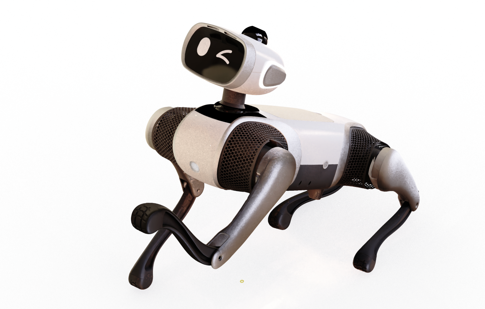
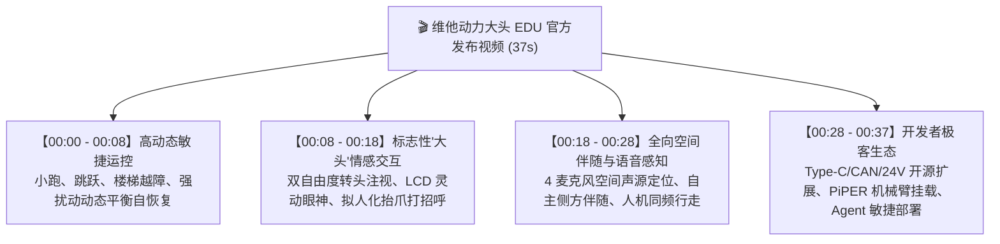
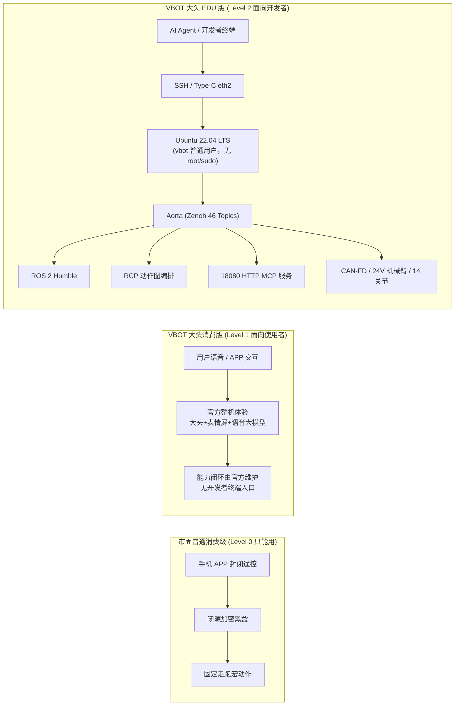

# 1.0 走进 VBOT 大头 EDU：产品全景、硬件规格与具身智能新物种

> 🎙️ **【直播口播导语】**  
> *“各位极客开发者、老师、同学们，以及守在直播间前对具身智能充满好奇的小伙伴们，大家晚上好！欢迎来到 VBOT EDU 具身智能大师课的第 0 讲！*  
> *提到四足机器狗，大家脑海里跳出来的形象往往是冰冷、硬核、甚至有点距离感的工业机器——没有表情，没有五官，只有一个冷冰冰的黑色机身在地上机械地踱步。但今天站在大家面前的这一只，完全颠覆了传统四足机器人的想象！*  
> *请看它——这就是维他动力（VitaDynamics）专为具身智能开发者打造的旗舰伙伴：**VBOT 大头 EDU 版**！它最醒目的标志，就是机头上方那颗拥有双自由度动态俯仰、搭载高清互动表情屏的‘大脑袋’！它不仅能摇头、眨眼、向你做鬼脸、转头注视你的目光，更重要的是，它是一台拥有 128 TOPS 超强板载算力、14 个高扭矩关节电机、全栈开放 Ubuntu 22.04 LTS 与 ROS 2 / Aorta 通信架构的‘移动具身智能实验台’！*  
> *无论你是刚入门具身智能的在校大学生、创客极客，还是正在用 Cursor / Claude Code 探索 Agent 控制的大模型开发者，这台机器狗都将是你从‘纯软件虚拟世界’踏入‘物理现实世界’的第一台终极伙伴。今天，我们就用 15 分钟，带你彻底揭开它的神秘面纱！”*

---

## 📸 整机硬件与产品外观全景

*图 1-0-1：VBOT 大头 EDU 四足机器人标准外观 —— 标志性的“大头”双自由度交互头部与模块化拓展身躯*

*图 1-0-2：VBOT 大头 EDU 在实操环境下的动态站立与头部主动注视姿态*

---

## 🎬 官方发布视频全景拆解：从动力敏捷到情感交互

在官方发布的 [《维他动力大头EDU发布视频》](../assets/videos/维他动力大头EDU发布视频.mp4)（时长 37 秒，1080×1920 竖屏高动态演示）中，整机展现出了四项颠覆性的技术飞跃。我们为直播讲师与初学者做逐帧核心卖点拆解：

### 1. 00:00 - 00:08 秒：极速爆发力与动态平衡
- **画面呈现**：机器狗在平地与阶梯地形中极速起步，采用高频 Trot（小跑）步态平稳穿行；遭遇外力踢击或台阶颠簸时，四足瞬间完成微秒级逆动力学重规划，毫无滞涩地恢复重心。
- **底层底气**：得益于机载 14 颗 VGeer 高集成度一体化关节电机（峰值扭矩高达 24.5 N·m）与 RTOS 网关板毫秒级力矩控制闭环。

### 2. 00:08 - 00:18 秒：有温度的具身伙伴（“大头”交互）
- **画面呈现**：镜头聚焦于标志性的头部机构——头部不仅拥有 Pitch（俯仰）和 Yaw（偏航）双轴动态转动能力，正面嵌入的高清液晶屏还能根据人声指令灵动切换眼神、眨眼、微笑，并自然抬起右前足向观众挥爪问好。
- **开发者启示**：打破了传统四足机器人“有身无首、缺乏朝向感知”的交互盲区，为医院导医、商圈导购、陪伴看护场景提供了天然的视线对齐（Eye-contact）接口。

### 3. 00:18 - 00:28 秒：空间听觉与伴随行走
- **画面呈现**：用户在侧方发出语音呼唤，头部阵列麦克风精准捕捉声源到达角（DOA），整机在 0.3 秒内同步转头并调整步速，与用户保持并排行走状态。
- **技术映射**：结合 360° 16 线激光雷达的局部避障与 SC230AI 双目深度视觉，机器狗不仅“看得见”，还能“听声辨位”。

### 4. 00:28 - 00:37 秒：开放为极客而生（Open Ecosystem）
- **画面呈现**：展示了机身背部的模块化快拆结构，开发者快速加装高负荷背筐、外置雷达支架、甚至直接在背板接入 PiPER 六轴机械臂进行移动抓取作业。
- **EDU 承诺**：向所有开发者开放底层通信总线（Aorta 46 核心话题）、提供 Linux 控制台与丰富 ROS 2 驱动，把"能改多深"交回开发者手里！

---

## 📊 官方核心技术规格总览（官网 Detail 数据解码）

参考 [维他动力官方产品规格库 (vbot.cn/Detail)](https://www.vbot.cn/Detail)，VBOT 大头 EDU 版的核心硬件参数整理如下：

| 系统分类 | 规格参数 | 官方工程指标与开发者意义 |
| :--- | :--- | :--- |
| **计算大脑** | 主控处理器 (SoC) | **地瓜 (DiGua) S100P** 异构高算力平台 |
| | CPU 核心架构 | 8 核心 **ARM Cortex-A78AE** 高性能低功耗车规级处理器 |
| | NPU 边缘 AI 算力 | **128 TOPS @ INT8**，支持机载运行 YOLOv11、MediaPipe、Whisper 及端侧 VLM 视觉大模型 |
| | 操作系统与中间件 | **Ubuntu 22.04 LTS (Jammy)** + **ROS 2 Humble** + **Aorta (Zenoh)** 原生总线 |
| **动力与关节**| 关节电机总数 | **14 个**（四足 12 关节：3 自由度/腿 × 4 + 头部 2 自由度：Pitch 俯仰 + Yaw 偏航） |
| | 电机型号与性能 | 自研 **VGeer** 高速力矩电机，峰值力矩 **24.5 N·m**，集成双绝对值磁编码器 |
| | 运动性能与步态 | 支持 Trot（小跑）、Walk（慢走）、Crawl（爬行）、Stair（楼梯步态）、自立站起、跳跃自恢复 |
| **全景感知** | 激光测距系统 | 顶部集成 **360° 16 线半固态激光雷达**，有效测距 0.1m ~ 30m，建图精度达厘米级 |
| | 视觉系统 | 前向集成 **SC230AI 双目立体视觉相机**，支持 H.264/H.265 硬件实时编解码 |
| | 听觉交互系统 | 头部集成 **4 麦克风环形空间阵列**，支持声源定位 (DOA)、波束成形降噪与 AEC 回声消除 |
| | 惯性导航与定位 | 内置工业级 **6 轴 IMU**（高精加速度计 + 陀螺仪）与 GNSS 定位模块 |
| **机身与负载**| 整机自重 (含电池)| **约 16.0 kg**（高刚性轻量化铝合金机身骨架 + 模块化 ABS 护壳） |
| | 物理外形尺寸 | 站立态约 **650 mm (长) × 380 mm (宽) × 450 mm (高)** |
| | 额定负载能力 | **5.0 kg**（可在额定负重下保持 1.5 m/s 连续动态巡航与运动编排） |
| | 结构极限极限负重 | **12.0 kg**（可承受机械臂瞬时冲击或大重量外挂设备） |
| **电池与续航**| 动力电池规格 | **594 Wh** 超大容量智能动力锂电池组，支持快速拔插锁紧机构 |
| | 持续作业续航 | 综合工况 **2.0 ~ 4.0 小时**；空载平稳站立待机可达 6 小时以上 |
| | 外设动力取电口 | 机身预留独立 **24V DC / 10A (峰值 15A)** 稳压电源输出接口，专供机械臂与高功耗外设 |
| **外设与通信**| 有线通信网口 | 机身侧方集成 **Type-C 多功能扩展口**（模拟千兆以太网 `eth2`，免驱免外接扩展坞） |
| | 工业级总线 | **双路隔离 CAN-FD 接口**，最高支持 1Mbps/5Mbps 速率，完美匹配 PiPER 六轴机械臂 |
| | 无线网络传输 | **Wi-Fi 6 (802.11ax)** + **蓝牙 5.2** + **UWB 超宽带空间定位**（由网关板 RTOS 托管） |

---

## ⚖️ 市面消费级 / 大头消费版 / 大头 EDU 三方对比

很多新手开发者会问："便宜的消费级机器狗能跑能跳，VBOT 自己的大头消费版也有会动的大头和表情屏，那做研发为什么还要选 **大头 EDU 版**？"

先把话讲明白：**大头消费版并不是"功能残缺版"**。2 自由度头部、互动液晶屏、表情与语音大模型这些能力它同样具备，面向普通用户开箱即用。EDU 版的差异不在硬件有没有，而在**开发者能不能进场**——所以下面这张表把三方分开列，避免把"给使用者做的产品"和"给开发者做的平台"混为一谈。

| 对比维度 | 市面普通消费级四足 | VBOT 大头消费版（面向使用者） | VBOT 大头 EDU（面向开发者） | 开发者影响与价值 |
| :--- | :--- | :--- | :--- | :--- |
| **1. 系统权限与终端** | 闭源沙盒固件；仅开放手机 App 遥控；无系统终端登录通道 | 开箱体验由官方整体维护；不开放 SSH 终端与开发者登录通道 | 开放 Linux 控制台与 `ssh vbot@192.168.126.2`；`vbot` 为**普通开发者用户**，当前 1.6 固件**未开放 root / sudo** | 可在家目录与 `/userdata/vbot` 用户空间装 Python/Conda、配 Git、用 `colcon` 编译自己的 ROS 2 包；系统级改动（apt 装系统包、改网络与内核、启停系统服务）需走官方支持或放到外接上位机上做 |
| **2. 通信中间件底座** | 厂商私有二进制加密协议；外接上位机需逆向破解；延迟高、丢包严重 | 机内总线不对用户开放，无外接上位机通道 | 原生搭载 **Aorta (Zenoh)** 边缘高吞吐主干总线（46 核心开放话题）+ **ROS 2 Humble 桥接子集** | 工业级、零拷贝、极低延迟通信，与学术界和产业界顶尖开源生态无缝对接 |
| **3. 原始传感器数据流** | 仅能在手机 App 里看压缩后的标清图传画面 | 雷达/相机/IMU 供官方内置的避障、跟随、语音能力自用，不向用户输出裸数据 | **全传感器裸数据高频广播**：激光雷达点云切片、双目 H.265/RGB 解畸变帧、IMU 100Hz 原始加速度、14 关节编码器数据 | 满足 SLAM 建图、Nav2 自主导航、目标识别检测、3D 点云避障等科研与商用落地需求 |
| **4. 头部交互系统** | 无独立头部，或仅有固定俯仰角度的塑料装饰壳；无互动屏幕；表情完全固定 | **同样具备 2 自由度动态头部 (Pitch/Yaw) + 高清互动液晶屏 + 4 麦克风阵列**，表情与声光反馈开箱即用（官方预置资源） | 同一套硬件，**并开放程序化写入通道**：表情帧/头部角度可由开发者代码实时驱动 | 支持自建表情资产、动态眼神凝视、表情帧缓冲直接写入（Framebuffer/UI）、多模态情感计算与交互 |
| **5. 硬件电气扩展** | 无外部电源引出，无标准工业总线；外挂传感器极易烧毁电池主板 | 以整机一体化形态交付，不面向用户开放外接取电与总线使能 | 配备专用 **Type-C 千兆免驱网口**、**双路隔离 CAN-FD**、独立 **24V/10A 大功率供电口** | 即插即用加装 PiPER 六轴机械臂、双目工业全景相机、Orin / RDK 外部算力板等复杂外设 |
| **6. AI 与开发范式** | 依赖按键映射与离线固定宏动作；无法接入大语言模型 (LLM/VLM) | **内置官方语音助手与大模型对话体验**，唤醒词与技能由官方预置，闭环不可替换 | **原生 Agent-Native 架构**：开放 RCP 任务编排系统、MCP (Model Context Protocol) 18080 服务，可接自有模型 | 开发者可直接通过自然语言提示词让大模型（GPT-4o/Qwen）驱动具身动作闭环！ |

> ⚠️ **权限边界要记牢**：EDU 版给你的是**一台能登录、能编译、能收发话题的 Linux 开发机**，而不是 root 机器。`vbot` 用户写不了系统目录、装不了系统包、使不了内核级接口。凡涉及这类需求，优先把逻辑放到外接上位机（Orin / RDK / 笔记本），或提前与官方确认支持路径。

---

## 💡 萌新开发者第一问：我需要提前准备什么？

如果你是一位刚刚踏入机器人领域的小白，请放轻松，你**不需要**精通逆运动学矩阵推导，也**不需要**有几百小时的嵌入式电路焊接经验。你只需要准备好以下工具和心态：

### 1. 硬件准备
- **你的开发主机**：一台安装了 Linux (Ubuntu 20.04/22.04)、macOS 或 Windows (推荐启用 WSL2) 的笔记本电脑；
- **连接线缆**：一根质量合格的双头 Type-C 数据线（或 Type-C 转 RJ45 千兆网线），用于接入机身侧方的 `eth2` 维护口；
- **安全场地**：一块至少 2m × 2m 的平整开阔空地（前几次测试建议在防滑地毯或干净地面进行，并清除脚边杂物）。

### 2. 软件与思维准备
- **基础终端技能**：懂得如何打开终端敲下 `ssh`、`ping` 和基本的 Python 脚本运行指令；
- **拥抱 AI Coding Agent**：文档库已针对 Cursor、Claude Code、Windsurf 等 AI 助手深度优化，遇到不懂的概念，随时把文档喂给 AI；
- **心法准则**：牢记具身开发的金科玉律——*“在虚拟世界里报错只是红字，在物理世界里失控机器狗是真的会撞墙！”* 时刻怀揣对物理硬件的敬畏之心。

---

## 🧭 下一步：迈出物理世界的第一步

了解完这只充满生命力与技术底蕴的“大头 EDU 具身新物种”之后，我们马上进入实操战备阶段！

请立刻点击下方链接，开始配置你的网络并完成首次机载系统登录：
👉 **下一章节：[1.1 极速开箱与网络接入](1.1-unboxing-and-network.md)**
