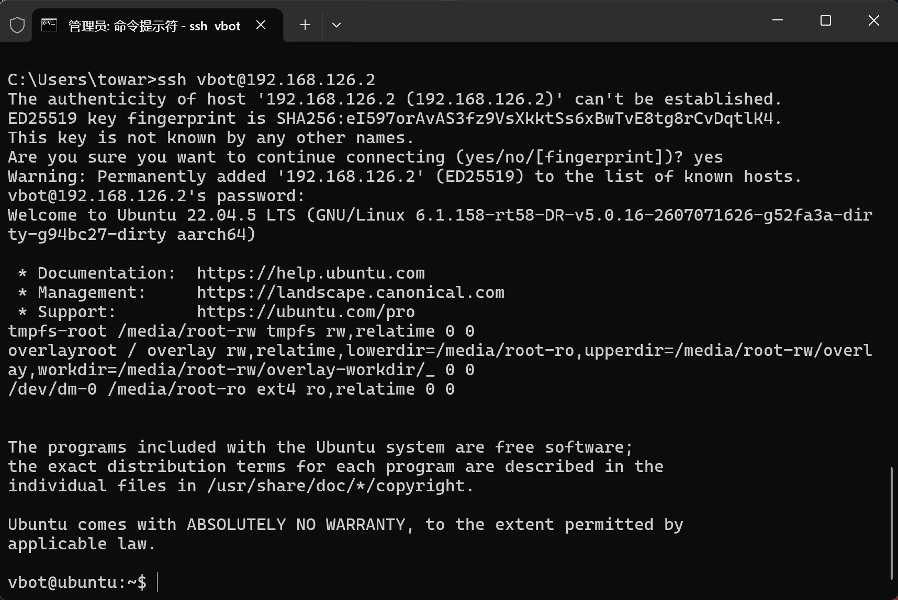
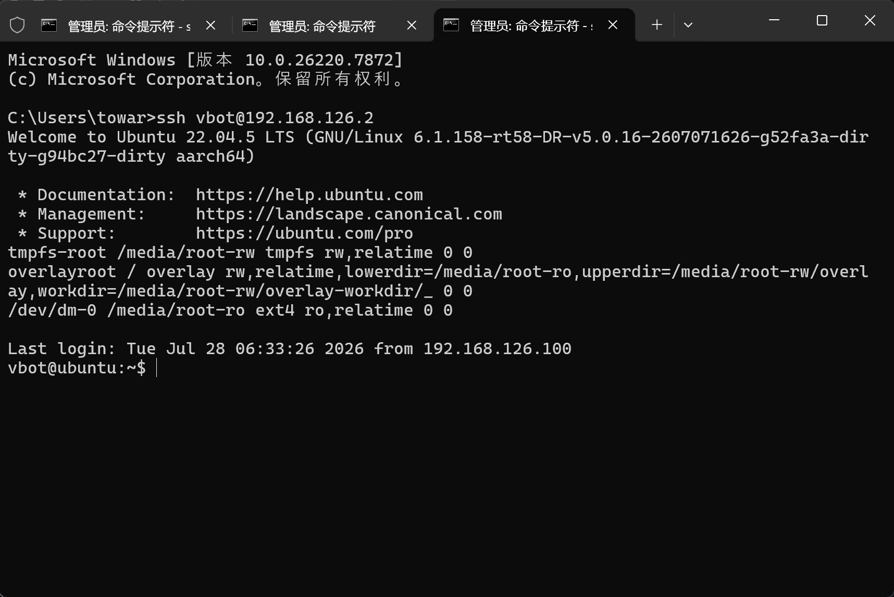
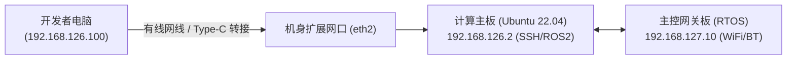

# 1.1 极速开箱与网络接入

> [!TIP]
> 如果你是首次接触 VBOT 大头 EDU 四足机器狗，建议先查阅前序导读：**[1.0 走进 VBOT 大头 EDU：产品全景、硬件规格与具身智能新物种](1.0-vbot-edu-overview.md)**，快速掌握 128TOPS 算力、14 关节电机、双脑架构与官方发布视频核心场景。

> 🎙️ **【直播口播导语】**  
> *“各位极客开发者、直播间的朋友们，大家晚上好！欢迎来到 VBOT EDU 具身智能大师课！  
> 很多朋友刚把这只沉甸甸的四足机器狗从航空箱里抱出来，第一件事就是‘连接电脑’。这一步看似人畜无害，其实一线现场暗坑无数！  
> 有的同学手一抖把电脑 IP 配成了 `.2`，跟机器狗自己撞车撞得两头失联；有的同学换了一台测试机，被 SSH 的 Host Key 报错拒之门外……  
> 今天这节课，我们把**‘有线千兆接入’**与**‘1.6 固件新增板载 Wi-Fi 直连’**两套打法倾囊相授，手把手教你配置 `ed25519` 密钥，让你只要在键盘上敲下 `ssh vbot` 四个字符，就能实现 1 秒免密直达！”*

---

## 📸 硬件外观与网络接入图解


*图 1-1：VBOT EDU 四足机器人标准外观，机身腹部与背部预留模块化扩展接口*


*图 1-2：初次通过命令行连接与网络接口检查流程*


*图 1-3：通过 SSH 成功登录计算主板并验证 Linux 内核与 Ubuntu 22.04 LTS 系统环境*

---

## 🛠️ 一、硬件端口与连接拓扑

VBOT 狗身具备两个核心计算单元：
1. **计算主板 (`192.168.126.2`)**：搭载 128TOPS 算力、Ubuntu 22.04 LTS 与 ROS 2 Humble，是开发者编写算法和运控代码的宿主机；
2. **主控网关板 (`192.168.127.10`)**：运行实时系统 (RTOS)，掌管整机电源管理、低级外设、Wi-Fi 与蓝牙。



---

## 🌐 二、接入方案 A：Type-C 有线网口直连（最稳固）

有线连接具备最高优先级、最低延迟和最强抗干扰能力，是**高频运动控制、大模型部署与黑客松现场调测的首选方式**。

### 1. 物理连线
* 使用配备的 Type-C 转千兆网口转接头，插入机器狗背部/腹部的扩展 Type-C 口（对应板载 `eth2` 物理网卡）；
* 另一端用网线连接至你的电脑网口。

### 2. 本地电脑网卡静态 IP 配置（避坑关键！）
为避免 DHCP 自动分配失败，必须将电脑连接机器狗的网卡设置为 **静态 (Static) IP**：

| 参数项 | 推荐配置值 | 深度工程解析 |
| :--- | :--- | :--- |
| **IP 地址** | `192.168.126.100` | **⚠️ 严禁配置为 `192.168.126.2`！** 配成 `.2` 会导致电脑与机器狗 IP 严重冲突，网络死锁！ |
| **子网掩码** | `255.255.255.0` (`/24`) | 确保与 `192.168.126.x` 处于同一广播域 |
| **默认网关** | **留空（不填）** | 留空可防止此网卡接管电脑外网访问路由，避免电脑无法上网查文档 |
| **DNS** | **留空（不填）** | 局域网直连无需解析域名 |

#### Windows PowerShell 管理员模式配置：
```powershell
# 将 "以太网" 替换为你实际的外接网卡名称
New-NetIPAddress -InterfaceAlias "以太网" -IPAddress 192.168.126.100 -PrefixLength 24
```

#### macOS / Linux 终端配置：
```bash
sudo ifconfig en0 192.168.126.100 netmask 255.255.255.0 up
```

### 3. 连通性测试
在终端中执行 Ping 命令：
```bash
ping 192.168.126.2
```
若正常返回类似 `64 bytes from 192.168.126.2: icmp_seq=1 ttl=64 time=0.8 ms`，说明物理链路与 IP 路由已完全畅通！

---

## 📶 三、接入方案 B：1.6 固件新增板载 WiFi 直连（告别网线）

> [!NOTE]
> 在 **V1.6.0 及以上版本固件** 中，官方正式上线了板载 Wi-Fi 直连调试能力，彻底摆脱了外接转接头与网线的物理束缚。

1. **进入开发者 Wi-Fi 模式**：
   * 机器狗上电开机，等待状态指示灯进入待命呼吸状态；
   * 手机 APP 连接机器狗，在「系统设置」→「开发者选项」中开启「板载 WiFi 调试模式」；或通过长按背部调试按钮 3 秒触发。
2. **连接 AP 热点**：
   * 电脑无线网卡搜索名为 `VBOT-EDU-XXXX` 的 Wi-Fi 热点并连接（默认初始密码详见机身铭牌或官方出厂卡片）；
   * 连接成功后，电脑将自动通过 DHCP 获取 `192.168.127.x` 网段 IP，计算板在此网段下的映射入口通常为 `192.168.127.2`。

---

## 🔑 四、建立 SSH 免密秒连通道

默认登录凭证：
* **用户**：`vbot`
* **初始密码**：`vbot` *(⚠️ 首次登录后建议立即执行 `passwd` 修改密码)*

### 1. 生成并推送 ed25519 密钥对
在本地终端中生成高安全性密钥并复制到机器狗：

```bash
# 本地生成密钥（已有则跳过）
ssh-keygen -t ed25519 -C "vbot-developer"

# 将公钥推送至机器狗（需输入一次默认密码 vbot）
ssh-copy-id vbot@192.168.126.2
```

### 2. 配置 SSH 别名 (`~/.ssh/config`)
在本地电脑的 `~/.ssh/config`（Windows 位于 `C:\Users\<你的用户名>\.ssh\config`）追加以下配置：

```ssh-config
Host vbot
    HostName 192.168.126.2
    User vbot
    IdentityFile ~/.ssh/id_ed25519
    ServerAliveInterval 30
    ServerAliveCountMax 3
```

### 3. 一秒登录自检
现在，只需在任何终端中输入四个字符：
```bash
ssh vbot
```
直接免密进入设备系统！执行自检命令验证硬件与系统版本：
```bash
uname -a
# Linux vbot 5.10.x-aarch64 #1 SMP Ubuntu 22.04 LTS
```

---

## 🛠️ 五、高频排错：清除 SSH Host Key 变更冲突

如果借用了另一台同 IP 的机器狗，可能会提示 `WARNING: REMOTE HOST IDENTIFICATION HAS CHANGED`。直接在本地电脑执行一行命令清除旧指纹：
```bash
ssh-keygen -R 192.168.126.2
```
重新执行 `ssh vbot` 即可顺畅连接！在 [1.2 跑通 Hello World](1.2-hello-world-motion.md) 中，我们将编写脚本让机器狗安全迈出第一步。
