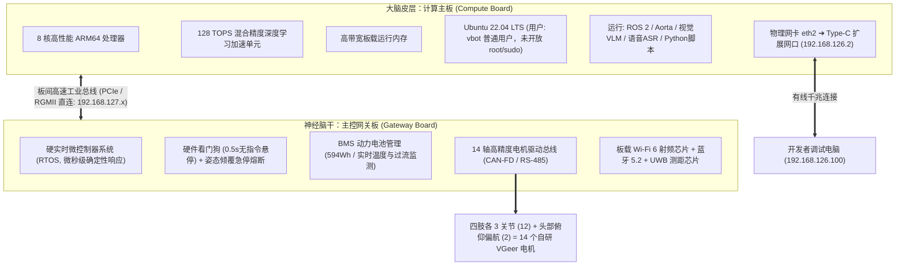

# 2.1 双大脑硬件架构拆解与物理边界

> 🎙️ **【直播口播导语】**  
> *“欢迎回到直播间！在上一篇，我们让机器狗稳稳走出了第一步。但现在，我们必须收起感性的兴奋，换上一副‘硬核工程师’的严谨眼镜。  
> 想安全地驾驭这只 16 公斤的钢铁机器狗，秘密就在于 VBOT 极其精妙的**‘双脑架构’**。打个生物学的比方：  
> - **计算主板**，就像是大脑皮层，专门负责高级的 Agent 规划、视觉思考和语音大模型推理；  
> - **网关主板**，就是它的神经系统与脑干，死死盯住底层的 14 个关键电机还有电源状态。  
> 哪怕你在大脑皮层跑的 AI 代码死锁甚至疯狂报错，底层的神经反射也能瞬间兜底，确保机器狗绝不会发疯撞墙！今天，我们就把这套生物级架构彻底扒开看清楚！”*

---

## 📸 硬件外观与仿真模型图景

*图 2-1：VBOT EDU 四足机器人标准外观，配备萌系交互大头与模块化扩展骨架*

*图 2-2：机身腹部与关节高集成度一体化电机排布实拍*

*图 2-3：Vbot Viewer 在线 3D 动力学模型检查，直观展示 14 关节连杆树与碰撞体*

---

## 🧠 一、计算主板 vs 主控网关板：双脑拓扑深度剖析

VBOT 放弃了消费级机器人常见的“单板大杂烩”设计，采用工业级物理级硬件隔离：

### 1. 计算主板 (`192.168.126.2`) —— 开发者的主战场
* **算力配置**：8 核 ARM64 处理器 + **128 TOPS NPU**。这是整个系统的“智力担当”，为轻量化视觉大模型（如 Qwen2-VL）、YOLO 实时目标追踪与 Cartographer 激光 SLAM 提供充沛算力；
* **开放程度**：官方为开发者开放 `ssh vbot@192.168.126.2` 登录计算主板。`vbot` 是**普通用户账号**——当前 1.6 固件**未开放 root / sudo**。你可以在用户空间（家目录、`/userdata/vbot`）里自由创建 Conda/Python 虚拟环境、配置 Git 仓库、用 `colcon` 把自己写的 ROS 2 包编译安装到用户目录；但 `apt` 安装系统包、改系统网络配置、加载内核模块、启停系统服务这类系统级操作并不在授权范围内，需要外接上位机承载或提前向官方申请支持；
* **数据接口**：对外暴露出机身唯一的千兆有线网络节点（对应系统内网卡 `eth2`，默认固定 IP `192.168.126.2`）。

### 2. 主控网关板 (`192.168.127.10`) —— 机器狗的生命盾牌
* **运行机制**：运行超低延迟、强确定性的硬实时操作系统 (RTOS)；
* **物理管辖**：直接控制分布在四肢与头部的 **14 个自研 VGeer 一体化高扭矩关节电机**；
* **不可越级性**：**不对外开放 SSH 或 Root 登录**。这构成了系统最底层的安全长城：即使计算主板的 Python 代码因为死循环或内存暴涨导致 Linux 内核当场挂起，网关板也能在毫秒级内切断动力或保持自平衡姿态，绝不让电机发生失控过扭。

---

## ❓ 二、极客经典困惑：为什么 Linux 里根本找不到 `wlan0`？

> 💡 **【学员弹幕高频提问】**  
> *“主播，我用网线连上机器狗 SSH 进去了，想给机器狗配个 Wi-Fi 连外网，执行 `ifconfig` 或 `ip link`，发现只有 `eth0`、`eth2`、`lo`，无线网卡 `wlan0` 到底去哪了？！”*

这是几乎所有刚接触 VBOT 的极客都会踩的第一个大坑！其背后的硬件工程考量极为深刻：

1. **射频软中断隔离**：传统无线网卡在进行 Wi-Fi 数据重传、信号协商时，会向 Linux CPU 发出大量不可控的软中断 (softirq)。在毫秒级的高频运动平衡控制中，哪怕 5ms 的延迟抖动都会导致机器狗落足不稳摔倒。因此，**物理 Wi-Fi 芯片直接硬件焊死在网关板上，与 Linux 计算板物理隔离**；
2. **虚拟网关路由**：在最新 1.6 固件中，当启用板载 Wi-Fi 时，网关板自身扮演了“路由器”角色，通过板间总线（`192.168.127.x` 网段）将无线流量透明转发给计算主板，开发者完全无需在 Linux 层折腾复杂的 `wpa_supplicant` 无线驱动！

---

## 🦾 三、14 个 VGeer 一体化关节动力学矩阵

理解关节命名与分布，是编写复杂运动与排查电机故障的基础：

| 关节归属 | 关节名称标识 | 运动自由度 | 物理功能与工程警示 |
| :--- | :--- | :--- | :--- |
| **左前肢 (FL)** | `FL_hip`, `FL_thigh`, `FL_calf` | 3 自由度 (航向/俯仰/屈伸) | 承载前向抓地力与避障支撑 |
| **右前肢 (FR)** | `FR_hip`, `FR_thigh`, `FR_calf` | 3 自由度 (航向/俯仰/屈伸) | 协同双目前端俯仰平衡 |
| **左后肢 (RL)** | `RL_hip`, `RL_thigh`, `RL_calf` | 3 自由度 (航向/俯仰/屈伸) | 主动力驱动推力来源 |
| **右后肢 (RR)** | `RR_hip`, `RR_thigh`, `RR_calf` | 3 自由度 (航向/俯仰/屈伸) | 主动力驱动推力来源 |
| **头部交互 (Head)** | `head_pitch`, `head_yaw` | 2 自由度 (俯仰 -30°~+45°, 偏航 ±60°) | 视场朝向与点头/摇头拟人交互，**禁止悬挂 >500g 负重** |

---

## 🎙️ 直播讲师小结与转场

> 🎙️ **【主播小结】**  
> *“好，地基打牢了！现在我们知道了：大脑皮层负责思考（计算板 `192.168.126.2`），脑干负责保命（网关板 `192.168.127.10`）。  
> 但是，两颗大脑之间到底靠什么语言对话？为什么你电脑上的 ROS 2 发指令狗根本不听？  
> 马上进入整套通信的最核心章节——[2.2 Aorta (Zenoh 46话题) 主干道与 ROS 2 兼容子集]！”*
