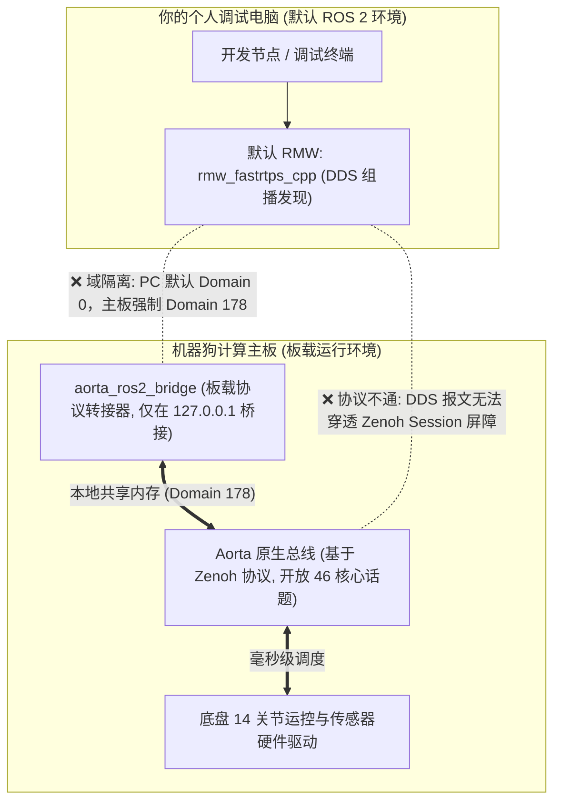

# 2.2 Aorta (Zenoh 46话题) 主干道与 ROS 2 兼容子集

> 🎙️ **【直播口播导语】**  
> *“各位直播间的同学们，请大家打起十二分精神！本节是整套进阶体系中价值最高、最容易拯救你生命的一堂课！  
> 几乎 90% 的 ROS 老手在刚拿到这台机器狗时，都会经历长达数天的怀疑人生：  
> *‘为什么我在自己笔记本电脑上明明能 ping 通机器狗，执行 `ros2 topic list` 甚至能看到话题名字，但执行 `ros2 topic echo /imu_raw` 却像死水一潭，半天吐不出来一个字节？为什么向 `/vel_cmd` 投递速度包，机器狗却稳如泰山、毫无反应？’*  
> 答案只有一句话：**Aorta 通信总线才是整个系统的绝对主力主干道，ROS 2 在这里仅仅是一个本地兼容子集！** 今天我们就来彻底拆穿这个‘通信巴别塔’的秘密！”*

---

## 🔍 一、根因拆解：协议隔离的“巴别塔”

传统 ROS 2（从 Foxy 到 Humble）默认采用基于 DDS (Data Distribution Service) 的中间件，其中最普及的是 eProsima 的 **FastRTPS**。FastRTPS 严重依赖于局域网内频繁的 UDP 组播发现机制。

然而，在追求高带宽视频流传输与端侧微秒级确定性的现代化具身机器人中，VBOT 自研了 **Aorta 通信框架**（底层基于 Eclipse 顶级开源项目 **Zenoh** 协议构建）：



### 为什么会出现“能看到话题却收不到数据”的灵异现象？
1. **网络层假握手**：偶尔看到的节点信息往往来自此前残留的组播缓存，真实的底层数据载荷全部流淌在 Zenoh 会话内，DDS 订阅者根本无法解包；
2. **域隔离 (Domain Isolation)**：板载 ROS 2 系统被硬件严格约束在 **`ROS_DOMAIN_ID=178`**。如果你的电脑运行在默认的 Domain 0，两者在物理逻辑端口上根本不在同一个次元；
3. **ACL 访问控制表的“静默丢弃”**：Aorta 内部配备了经过强类型校验的 56 行 EDU Schema 规则。**任何未在白名单中声明的非法话题名或非法数据类型，在总线层面会被直接静默丢弃**（既不向你报错，也不给你响应），表现为完全没有反应！

---

## 🛣️ 二、46 条 Aorta 核心话题全景速查

Aorta 总线向开发者一次性开放了 **46 条核心话题**（包括 43 条高频遥测输出与 3 条控制输入），常用核心路径速查如下：

| 功能模块 | Aorta 原生路由 (主干道) | ROS 2 本地桥接话题 | 传输语义 / 频次 / 消息类型 |
| :--- | :--- | :--- | :--- |
| **底盘速度输入** | `/locomotion/velocity_command` | **`/vel_cmd`** | **唯一合法底盘速度写入**，20Hz 连续输入 (`Twist`) |
| **手柄遥控输入** | `/locomotion/joy` | `/joy` | 模拟遥控器摇杆与按键状态 (`Joy`) |
| **耳灯调制输入** | `/light/ear_modulation` | `/light/ear_modulation` | 左右耳 RGB 灯光动态调制输入 |
| **机身高频姿态** | `/imu_raw` | `/lowlevel/imu_raw` | 100Hz 原始加速度计/陀螺仪/四元数 (`Imu`) |
| **360° 激光雷达** | `/lidar_points` | `/vbot/lidar/point_cloud` | 10Hz 三维空间深度点云 (`PointCloud2`) |
| **双目视频流** | `/image_left_raw/h265` | - | H.265 硬件视频压缩编码流 (需 Aorta SDK) |
| **17点人体骨骼**| `/perception/poses` | `/perception/poses` | NPU 内置骨骼模型推理结果 (Logit 置信度) |
| **BMS 电池健康** | `/bms_state` | `/vbot/bms_state` | 实时电量百分比、母线电压、各电芯温度 |
| **RCP 任务编排** | `/rcp/execute_task` | `/rcp/execute_task` | Action 动作流服务 (支持 DAG 任务图) |

---

## 💡 三、破壁两套解决方案

### 方案 A：板载节点运行模式（强烈推荐 ⭐⭐⭐⭐⭐）
**一句话法则：不要在你的电脑上去费劲编译配置一整套 RMW，直接 SSH 登录到机器狗计算主板上写代码！**

* **零拷贝极速通信**：节点间直接通过 Linux 共享内存 (POSIX Shared Memory) 通信，传输延迟 **< 0.2 毫秒**，完全摆脱 Wi-Fi 丢包困扰；
* **环境完全开箱即用**：主板出厂即预装了完全匹配的 `aorta-sdk` 与 `vbot_ros2_msgs`。

#### 板载快速启动环境配置：
在计算主板终端的 `~/.bashrc` 尾部，确保包含官方标准注入块：
```bash
# 激活板载 ROS 2 与 Aorta 运行时
source /opt/vita/ros/humble/setup.bash
source /opt/vita/aorta/ros/local_setup.bash

# 强制绑定本地回环与官方 178 域
export ROS_DOMAIN_ID=178
export ROS_LOCALHOST_ONLY=1
export ZENOH_SESSION_CONFIG_URI=/opt/vita/aorta/edu/edu_session.json5
```

### 方案 B：PC 电脑安装 Zenoh RMW 插件（仅用于外接 GPU 工作站）
如果你有一台外挂的 RTX 4090 移动工作站需要订阅全量激光点云：
```bash
# 1. 在 PC 上安装 Zenoh RMW
sudo apt update && sudo apt install ros-humble-rmw-zenoh-cpp

# 2. 导出环境变量
export RMW_IMPLEMENTATION=rmw_zenoh_cpp
export ROS_DOMAIN_ID=178
# 3. 此时再执行 echo 即可畅通接收数据流
ros2 topic echo /lowlevel/imu_raw
```

---

## 🛠️ 四、Aorta 命令行万能探针（排障杀手锏）

在计算主板上，善用官方提供的 `aorta` CLI 工具，能在 3 秒内摸清总线状况：

```bash
# 1. 查看总线上当前所有活跃的话题清单
aorta topic list

# 2. 采样 1 条 IMU 原始报文验证总线是否真的活蹦乱跳
aorta topic echo /imu_raw --count 1

# 3. 检查所有注册的 RPC 服务
aorta service list

# 4. 打印指定话题的底层数据结构契约描述
aorta schema get /imu_raw --describe
```

---

## 🎙️ 直播讲师小结与转场

> 🎙️ **【主播小结】**  
> *“记住这条黄金铁律：**Aorta 是主动脉，ROS 2 是小支流，通信对齐 Domain 178，写代码直接上板载！**  
> 搞清楚了通信主干，接下来我们就要部署环境了！怎么搭建标准容器？怎么跑通官方标准的五步部署法？  
> 马上进入 [2.3 规范化开发环境搭建与生产级 Python 骨架]！”*
