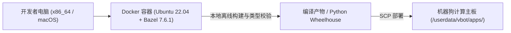
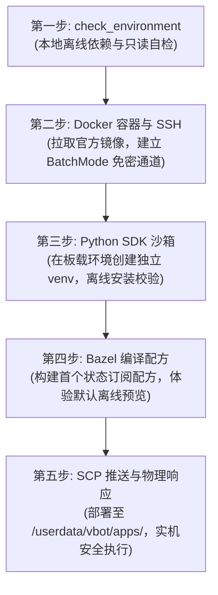

# 2.3 规范化开发环境搭建与生产级 Python 骨架

> 🎙️ **【直播口播导语】**  
> *“很多初学者的代码往往‘在自己电脑上跑得好好的，一到机器人实机上就发疯死锁、内存暴涨或引发看门狗摔机’。  
> 还有人一拿到机器狗，脑袋一热就直接在实机上改生产配置，结果系统直接崩溃变砖！  
> 本章将带你了解官方推荐的 **DevContainer 容器化开发工具链**，掌握贯穿实战的**‘端到端五步部署法’**，并深入解析 `vbot-lab` 中被誉为工程典范的 **`recipes/common.py` 生产级防御性代码骨架**！”*

---

## 🐳 一、开发环境容器化：DevContainer 与 Bazel

为了杜绝因主机系统差异导致的 GCC 版本不匹配与 aarch64 交叉编译地狱，官方提供了标准开发容器：



### 1. 容器一键启动
在 VS Code 中安装 `Dev Containers` 插件，打开工作区后选择 **"Reopen in Container"**，或在命令行执行：
```bash
docker compose -f docker/compose.yaml run --rm dev
```

### 2. Bazel 离线语法检查与构建
官方项目全面采用 Google Bazel 构建系统：
```bash
# 本地快速类型检查与离线逻辑预览（无需物理连接机器狗）
bazel run //recipes/subscribe-state:main

# 编译 C++ 生产级节点
bazel build //recipes/locomotion:main_cpp
```

---

## 🚀 二、官方端到端五步部署工作流 (End-to-End Workflow)

千万别一上来就盲目把代码塞进机器狗，跟着这五步走，保证万无一失：



1. **Step 1: check_environment 离线自检**：
   在本地运行 `python3 tools/check_environment.py --profile host`，确认本地 Python ≥ 3.10、Docker 与 SSH 客户端完备。
2. **Step 2: 建立安全通道**：
   通过 `ssh-copy-id` 注入 `ed25519` 公钥，通过 `ssh -o BatchMode=yes vbot true` 验证免密畅通。
3. **Step 3: 端侧环境隔离**：
   登录主板后在 `/userdata/vbot/` 下创建独立 `venv`，验证 SHA256 校验和并安装 `edu-sdk-2026.9.24` 三件套。
4. **Step 4: 离线预览守卫**：
   使用 Bazel 编译测试配方，在未带 `--execute` 标志前，程序仅向终端打印 JSON 预览，杜绝误操作。
5. **Step 5: 物理响应验证**：
   使用 SCP 推送程序包，登录实机加上 `--execute` 与 `--confirm-motion`，见证物理四足的真实响应！

---

## 🛡️ 三、深度解构生产级代码骨架 (`recipes/common.py`)

在 `vbot-lab` 中，所有任务脚本都严格继承自 `recipes/common.py`。这 140 多行代码凝结了工业级机器人开发的 **六大核心防御性原则**：

### 1. 默认离线安全 (Offline-First Safety)
* **执行策略**：凡是不带 `--execute` 参数的运行命令，程序**绝不向底层下发任何物理位移报文**，仅向终端打印 JSON 格式的目标动作预览；
* 运动控制必须显式传递 `--confirm-motion`；
* 麦克风录音与摄像头采流必须显式传递 `--consent`。

### 2. 有界一切 (Bounded Everything)
机器狗的板载内存与实时线程极其宝贵，拒绝任何无限扩张的数据结构：
* **超时有界**：所有网络接收超时强制约束在 `(0, 120]` 秒内，杜绝无超时等待导致的永久挂死；
* **队列深度截断**：Aorta 消息接收队列深度严格限定为 **16**，一旦接收线程消费不及时，主动丢弃最旧样本并向 stderr 抛出警告，防止内存 OOM 撑爆主板；
* **单样本体积上限**：单个点云或图像数据包上限截断为 **8 MiB**。

### 3. 版本硬性钉死 (Strict Metadata Pinning)
在脚本启动前，必须通过 `importlib.metadata` 校验 SDK 三件套（`aorta`、`aorta-msgs`、`vbot-edu-msgs`）的版本号。版本号不一致立刻阻断，杜绝“因协议版本错位引发不可预测动作”。

### 4. 优雅停机与安全归零
捕获系统的 `SIGINT` (Ctrl+C) 与 `SIGTERM` 信号，在进程退出的微秒级时间窗口内，向底盘注入全零速度急停报文。

---

## 📝 四、极简标准工程模板

在开发自己的 Python 二开项目时，推荐遵循以下结构：

```python
import argparse
import sys
import time

def parse_args():
    parser = argparse.ArgumentParser(description="VBOT 生产级任务节点")
    parser.add_argument("--execute", action="store_true", help="允许向机器人实机写入指令")
    parser.add_argument("--timeout", type=float, default=10.0, help="任务有界超时时间(1-120秒)")
    parser.add_argument("--confirm-motion", action="store_true", help="运动授权确认")
    return parser.parse_args()

def main():
    args = parse_args()
    
    # 1. 强制超时范围校验
    if not (0 < args.timeout <= 120):
        print(f"❌ 错误: 超时时间 {args.timeout}s 超出有效安全区间 (0, 120]！", file=sys.stderr)
        sys.exit(1)

    # 2. 离线预览守卫
    if not args.execute:
        print("ℹ️ [离线预览模式] 当前未传入 --execute，仅输出仿真参数：")
        print(f"{{ 'target_timeout': {args.timeout}, 'motion_confirmed': {args.confirm_motion} }}")
        sys.exit(0)

    # 3. 核心业务逻辑（带异常兜底）
    print("🚀 [实机执行] 正在启动机器人控制任务...")
    try:
        # TODO: 执行具身智能逻辑
        time.sleep(1)
    except KeyboardInterrupt:
        print("\n⚠️ 任务被外部中断，正在恢复待命状态...", file=sys.stderr)
    finally:
        print("✅ 资源安全释放，退出。")

if __name__ == '__main__':
    main()
```

掌握了标准规范后，接下来让我们进入激动人心的核心模块 —— [03 运控、感知与多模态 Agent](../03-embodied-agent/3.1-motion-control-and-rcp.md)！
