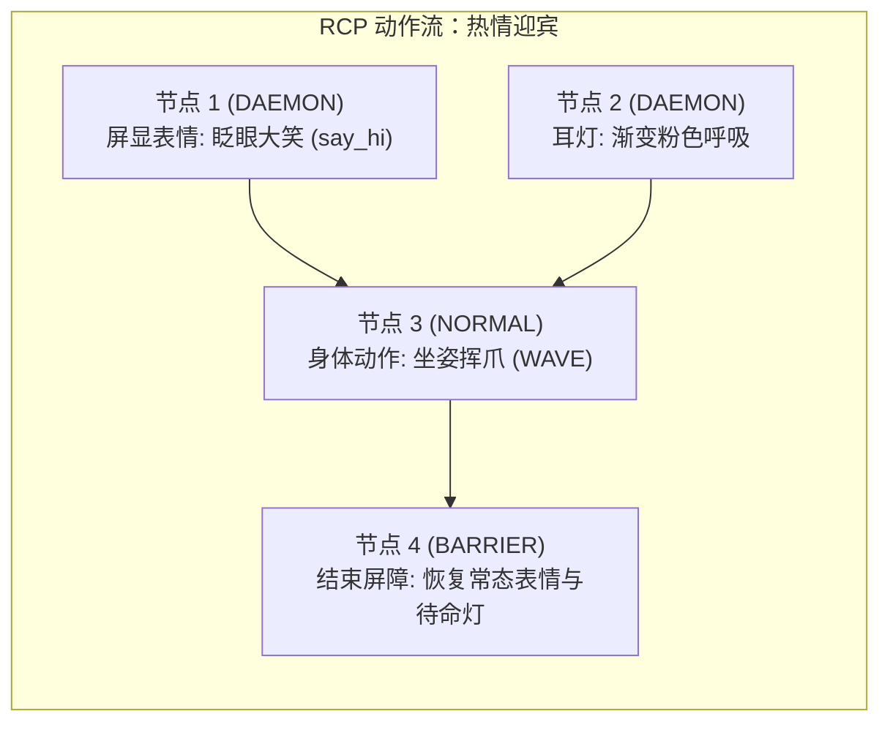

# 3.1 运动控制进阶与 RCP DAG 动作流编排

> 🎙️ **【直播口播导语】**  
> *“底盘平稳走动只是基础，让机器狗‘既能走路、又能摇尾巴、大头屏幕眨眼、耳灯变色、同时播报语音’，才是具身智能交互的核心魅力！  
> 很多从传统 ROS 2 走过来的开发者，脑子里只认一种最土、最暴力的控制办法：  
> 写一个 `while True` 死循环，以每秒钟 20 次的极高频率向 `/vel_cmd` 疯狂丢速度数据！  
> 同学们，频繁加减速造成的动力学冲击，会让减速箱齿轮剧烈磨损、电机温升直线上升；而且你根本没法做到‘边走路、边转头看人、边眨眼睛、边放背景音乐’！  
> 今天这节课，我们要郑重向大家介绍 VBOT 真正的工程王牌——**RCP (Robot Command Pipeline) 任务编排系统**！  
> 彻底告别 20Hz 离散折磨，学会用 DAG 有向无环图编排丝滑如丝绸的动作流！”*

---

## ⚖️ 一、双控制路径辨析：直接服务 vs RCP（最易踩坑点）

> [!CAUTION]
> **黄金法则：同一时刻、同一物理资源，绝对不要混用两条控制路径！**
> 当 RCP 任务正在占用 `LEGS` 腿部资源执行一段挥手动作时，严禁并发调用 `/vel_cmd` 发布速度，否则会导致底层电机轨迹冲突并引发保护性停机。

| 控制路径 | 适用场景 | 核心接口 | 优势 | 局限 |
| :--- | :--- | :--- | :--- | :--- |
| **路径一：直接服务 / 话题** | 遥控器连续操纵、SLAM 避障巡航、实时速度跟随 | 话题 `/vel_cmd`<br>服务 `set_run_mode` | 实时性最高（延迟 < 5ms） | 无法实现声光电姿态多模态同步 |
| **路径二：RCP 任务图 (DAG)** | 拟人情感表达、迎宾走秀、复合连招（如作揖+屏幕比心+闪烁耳灯） | Action `/rcp/execute_task` | 强时序原子性、资源自动加锁、支持并发与等待屏障 | 属于离散任务流，不适合连续高频航向微调 |

---

## 🧩 二、RCP 动作编排架构与核心要素

RCP 采用类似微服务工作流的 **DAG (Directed Acyclic Graph) 有向无环图** 结构定义任务：



### 1. 物理资源锁 (Required Resources)
每一个 RCP 任务必须预先声明其锁定的硬件资源枚举，防止资源死锁：
* `LEGS`（四肢运控）
* `HEAD`（头部俯仰/偏航电机）
* `SCREEN`（面部 LCD 交互屏）
* `LIGHT`（左右耳部 RGB 调制氛围灯）
* `AUDIO_OUT`（板载高保真扬声器）

### 2. 三大生命周期策略 (Lifecycle)
* **`NORMAL`**：阻塞执行，必须等待该节点完全完成（如身体动作做完）才放行后继节点；
* **`DAEMON`**：后台常驻，启动后立刻放行后继节点（例如：动作刚启动时，立刻并行点亮表情和大灯）；
* **`BARRIER`**：同步屏障，一旦执行，自动取消当前图内所有常驻的 `DAEMON` 节点并安全复位。

---

## 🛠️ 三、实战：执行官方预设动作与自定义 DAG

### 1. 调用官方预设动作 (`DagPresetRef`)
官方系统内置了数十种高难度特技与姿态预设（如坐下、趴下、挥手、转圈）。使用 Aorta Python SDK 调用预设动作：

```python
import time
from aorta import Node
from aorta.rcp import RcpClient

def play_wave():
    # 建立 RCP 客户端
    node = Node("vbot_wave_demo")
    client = RcpClient(node)
    
    print("🐾 正在下发官方挥手预设动作...")
    # 引用预设动作 WAVE.json
    handle = client.execute_preset(
        preset_name="actions/WAVE.json",
        timeout=10.0
    )
    
    # 等待任务结果（受理 != 执行完成，需等待最终终态）
    result = handle.wait_completed()
    if result.is_success:
        print("🎉 挥手动作圆满完成！")
    else:
        print(f"❌ 动作被中断或拒绝: {result.error_message}")

if __name__ == '__main__':
    play_wave()
```

### 2. 状态机规范：站立与趴下的正确打开方式
* **站起姿态**：调用服务 `set_run_mode(MANUAL=0)`；
* **安全趴下**：必须调用 `lowlevel_action(SAFE_LAYDOWN_SEQUENCE=4)`，按四肢缓降时序收缩；**切忌凭字面意义暴力下发全零关节点击**，否则机器狗会因瞬间失重重摔着地！

掌握了多模态运动编排后，接下来我们在 [3.2 激光雷达、双目视觉与骨骼姿态感知](3.2-perception-data-streams.md) 中为机器狗装上“眼睛与触角”。
