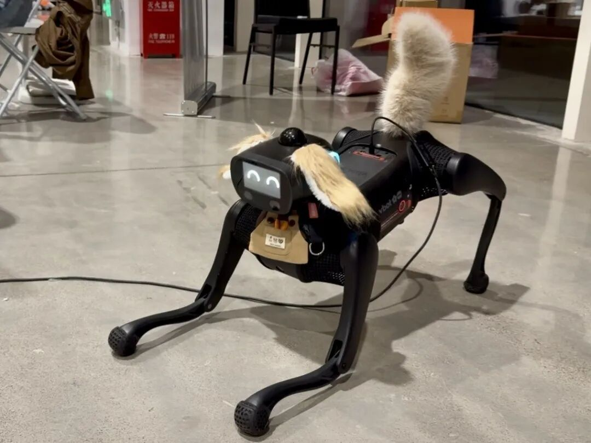

# 3.2 激光雷达、双目视觉与骨骼姿态感知

> 🎙️ **【直播口播导语】**  
> *“要想具身机器人真正能理解物理空间、懂得避让人群，它的眼睛和触角绝不能‘近视’！  
> VBOT 机身配备了一套极其豪华的端侧感知矩阵：360° 16 线激光雷达、广角双目深度相机、高频 IMU，甚至主板 NPU 已经常驻运行了实时人体检测与 17 点骨骼姿态识别！  
> 但是，很多同学拿着网上的公开教程直接硬套，结果发现：点云把 CPU 吃满了、双目画面延迟长达 2 秒、骨骼置信度全被过滤空了！  
> 今天这节课，我们就逐一解锁三大核心传感器数据流的最佳实践，并手把手带大家跨过‘原始 Logit 置信度转换’这道最经典的工程暗坑！”*

---

## 📡 一、360° 16 线激光雷达：建图与避障切片

机器狗腹部与顶部集成的高频激光雷达持续以 10Hz 输出全向三维空间点云：
* **ROS 2 话题**：`/vbot/lidar/point_cloud`
* **消息类型**：`sensor_msgs/msg/PointCloud2`

### 避障与 Nav2 适配要点：
* 点云坐标系通常绑定在 `lidar_link` 或 `base_link`；
* **点云切片降维投影**：在板载 ARM64 处理器上，如果直接拿 10 万个三维点云去计算 3D 障碍物膨胀代价，CPU 占用率会瞬间突破 70%。推荐启动 `pointcloud_to_laserscan` 转换节点，将高度处于 $[0.1\text{m}, 0.6\text{m}]$ 范围内的 3D 点云切片投影为**二维雷达射线扫描包 (`sensor_msgs/msg/LaserScan`)**。算法开销骤降 80%，避障反应速度提升 5 倍！

---

## 📷 二、深度双目相机：H.265 硬件视频流解析

为了在板载百兆/千兆总线上稳定传输 1080P@30fps 双目画面，系统**不在网络上直接广播无压缩的原始 BGR8 像素矩阵**（未压缩双目码流高达 1.5 Gbps ~ 3.0 Gbps，会瞬间挤爆总线导致运动卡顿），而是采用硬件编码压缩：
* **核心话题**：`/image_left_raw/h265`
* **编码格式**：H.265 / HEVC 视频流

### Python 实时解码与去畸变流水线：
使用 `av` (PyAV) 库配合板载硬件解码加速，开箱即用：

```python
import av
import cv2
import numpy as np

def decode_h265_frame(h265_bytes):
    """将接收到的 H.265 字节包解码为 OpenCV BGR 图像"""
    container = av.open(h265_bytes, format='h265')
    for frame in container.decode(video=0):
        # 转换为 NumPy BGR 矩阵
        img = frame.to_ndarray(format='bgr24')
        return img
    return None
```

---

## 🧍 三、板载 NPU 人体感知：17 点骨骼识别 (`/perception/poses`)


*📸 案例参照：伽伽狗依据 17 点骨骼关键点的相对距离与角度判定下犬式，并截取动作片段重编排来“模仿”人（详见 [4.3 CASE-02](../04-hardware-recipes/4.3-hackathon-blueprints.md)）*


> [!IMPORTANT]
> **官方模型免部署福利**：你不需要在自己代码里额外运行耗费算力的 OpenPose 或 YOLO-Pose！
> VBOT 计算主板的 NPU 已经在后台常驻运行了实时人体检测与 17 点骨骼姿态估计算法，直接订阅话题即可获得解析结果。

* **订阅话题**：`/perception/poses`
* **数据结构**：包含每个检测到的人员边界框与 17 个 COCO 骨骼关键点（鼻子、左/右眼、左/右耳、肩、肘、腕、髋、膝、踝）。

### ⚠️ 最易踩坑点：关键点置信度是 Logit，非概率！
许多开发者在过滤噪点时直接写 `if point.confidence > 0.5`，结果发现所有点都被过滤掉了。
**官方接口返回的 `confidence` 字段是未经激活函数计算的原始 Logit 实数值**！必须通过 Sigmoid 函数映射为 `[0.0, 1.0]` 区间：

$$\text{Probability} = \frac{1}{1 + e^{-\text{logit}}}$$

#### Python 提取标准示例：
```python
import math

def extract_keypoints(pose_msg):
    """解析 17 点骨骼关键点并还原真实置信度概率"""
    parsed_people = []
    
    for person in pose_msg.persons:
        kps = []
        for raw_kp in person.keypoints:
            # 执行 Sigmoid 转换
            prob = 1.0 / (1.0 + math.exp(-raw_kp.confidence))
            kps.append({
                "x": raw_kp.x,       # 像素坐标 X
                "y": raw_kp.y,       # 像素坐标 Y
                "prob": prob        # 真实概率 (0.0 ~ 1.0)
            })
        parsed_people.append(kps)
        
    return parsed_people
```

---

## 🧭 四、IMU 惯导遥测 (`/imu_raw`)

高频 100Hz 的姿态反馈对于越野平稳控制与跌倒判定至关重要：
* 包含 `linear_acceleration`（三轴加速度）、`angular_velocity`（三轴角速度）与 `orientation`（四元数姿态）；
* **初学者自检建议**：在调试通信环境时，推荐优先订阅 `/imu_raw` 一条话题进行链路冒烟测试，因为它的报文体积小、刷新率高，能极快验证 RMW 是否真正通畅。

有了视觉、听觉与姿态感知，在下一章 [3.3 多模态大模型接入与板载 MCP 服务](3.3-ai-native-multimodal.md) 中，我们将为机器狗赋予大模型的推理决策中枢！
