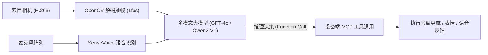

# 3.3 多模态大模型集成与设备端 MCP 工具

> 🎙️ **【直播口播导语】**  
> *“如果大模型只能在屏幕聊天框里陪你打字，那它不过是一个昂贵的统计学文字玩具；但如果给大模型插上一双‘能看、能走、能表达’的物理手脚，它就是真正能够改造现实世界的具身智能体！  
> 最近，Anthropic 主导的 **MCP (Model Context Protocol, 模型上下文协议)** 彻底引爆了全球 AI 圈。  
> 你知道吗？VBOT 官方在底座设计中，早已为端侧 MCP 与 Agent Harness 留好了原生接口！  
> 今天这节课，我们就手把手带你在计算主板上拉起一个高性能的 **18080 MCP 工具服务器**，让 Cursor、Claude Code 或者任何大模型智能体，直接像调用本地函数一样操纵这台钢铁猛兽！”*

---


*📸 案例参照：牛来芭比“多模态输入 → 情绪语义理解 → 动作生成 → 物理执行”五环节链路，3~5 秒云端延迟用“微动作垫场”化解（详见 [4.3 CASE-03](../04-hardware-recipes/4.3-hackathon-blueprints.md)）*


*📸 案例参照：伽伽狗团队用 Sherpa 在外部接管音频流，把唤醒词换成“伽伽”*

---

## 🎙️ 一、板载音频链路与自定义唤醒词

机器狗头部集成了四麦克风阵列与降噪算法：
* **原始音频流**：`/raw_audio_dump`（需用户显式传递 `--consent` 权限）
* **板载识别文本**：`/speech/asr_result`（实时输出 ASR 识别出的文字）
* **语音播报服务**：可通过音频节点直接投递 WAV/PCM 音频包播放语音。

### 唤醒词热替换与离线语音栈：
黑客松实战中（如“聆灵陪诊”、“伽伽狗”），选手们通常会旁路系统内置唤醒词，构建独立的语音闭环：
1. **音频流截流**：在后台启动轻量 Python 节点监听麦克风流；
2. **轻量语音唤醒**：接入 OpenWakeWord 或 Sherpa-ONNX，加载专属唤醒词模型（如唤醒“小安”或“聆灵”）；
3. **流式语音识别**：唤醒后启动阿里 SenseVoice 或 OpenAI Whisper 进行高精度语音转文字，随后注入 LLM。

---

## 👁️ 二、VLM 视觉认知决策流水线

传统机器人只知道“前方 0.8 米有障碍物”，而搭载视觉大模型的机器狗知道**“地上有一双散落的瑜伽袜，或者有一位老人摔倒需要呼救”**。



### 决策设计准则：
* **抽帧降频**：不要将 30fps 全量视频喂给云端 VLM（延迟与 Token 成本不可接受）；通常以 **1 帧/秒** 或在检测到用户提问时按需触发单帧截取；
* **结构化输出**：强制大模型以 JSON 格式输出 `tool_name` 与 `arguments`。

---

## 🛠️ 三、设备端 MCP (Model Context Protocol) 工具服务挂载

Anthropic 提出的 **MCP (模型上下文协议)** 已经成为连接 AI 与物理世界的标准接口。通过在机器狗上部署 MCP 服务，任何兼容的大模型（Claude Code, Cursor, AutoGPT 等）都能自然地操纵机器狗。

### 1. 端口与网络规约
* **MCP 服务统一入口**：`http://192.168.127.2:18080/mcp`
* **设备 Skill 动态注入入口**：`http://192.168.127.10:8787/api/skills/{name}`
* ⚠️ **网络安全底线**：18080 与 8787 端口仅留在内网，**严禁使用 frp 或公网穿透直接暴露到公网**！

### 2. 生产级 MCP 工具服务端示例 (`vbot_mcp_service.py`)

```python
#!/usr/bin/env python3
# -*- coding: utf-8 -*-
"""
VBOT 设备端生产级 MCP (Model Context Protocol) 核心服务
运行端口：18080
"""

from fastapi import FastAPI, Request
import uvicorn
import time

app = FastAPI(title="VBOT Embodied MCP Gateway", version="1.6.0")

# 声明向大模型暴露的具身工具清单
TOOLS_CATALOG = [
    {
        "name": "vbot_locomotion_walk",
        "description": "驱动机器狗以指定线速度平稳移动一段指定时间，支持前后与转向",
        "inputSchema": {
            "type": "object",
            "properties": {
                "linear_x": {"type": "number", "description": "前进线速度 (m/s)，建议范围 -0.3 ~ 0.5"},
                "angular_z": {"type": "number", "description": "旋转角速度 (rad/s)，正值为左转，负值为右转"},
                "duration": {"type": "number", "description": "持续秒数，范围 (0.5, 10.0]"}
            },
            "required": ["linear_x", "duration"]
        }
    },
    {
        "name": "vbot_set_emotion",
        "description": "在头部 LCD 屏幕上渲染预设表情，并伴随耳灯 RGB 呼吸效果",
        "inputSchema": {
            "type": "object",
            "properties": {
                "emotion": {
                    "type": "string",
                    "enum": ["happy", "wink", "surprised", "confused", "sad", "neutral"],
                    "description": "表情类型"
                }
            },
            "required": ["emotion"]
        }
    },
    {
        "name": "vbot_capture_environment",
        "description": "抓取当前双目相机前端的一帧高清实拍画面，供多模态视觉大模型做空间分析",
        "inputSchema": {
            "type": "object",
            "properties": {
                "camera_select": {"type": "string", "enum": ["left", "right"], "default": "left"}
            }
        }
    }
]

@app.post("/mcp")
async def handle_mcp_request(request: Request):
    payload = await request.json()
    rpc_method = payload.get("method")
    call_id = payload.get("id")
    params = payload.get("params", {})

    # 1. 响应工具清单查询
    if rpc_method == "tools/list":
        return {
            "jsonrpc": "2.0",
            "id": call_id,
            "result": {"tools": TOOLS_CATALOG}
        }

    # 2. 响应具体工具执行
    elif rpc_method == "tools/call":
        tool_name = params.get("name")
        args = params.get("arguments", {})

        if tool_name == "vbot_locomotion_walk":
            vx = float(args.get("linear_x", 0.0))
            wz = float(args.get("angular_z", 0.0))
            dur = float(args.get("duration", 1.0))
            print(f"🐾 [MCP 运控] 收到行走指令: vx={vx}m/s, wz={wz}rad/s, 持续={dur}s")
            
            # TODO: 实际代码中调用 /vel_cmd 发布器执行 20Hz 连续投递
            time.sleep(0.1)
            return {
                "jsonrpc": "2.0",
                "id": call_id,
                "result": {
                    "content": [{"type": "text", "text": f"✅ 机器狗成功完成行走: vx={vx}, wz={wz}, 耗时={dur}秒"}]
                }
            }

        elif tool_name == "vbot_set_emotion":
            emo = args.get("emotion")
            print(f"🐶 [MCP 表情] 切换头部屏幕表情至: {emo}")
            return {
                "jsonrpc": "2.0",
                "id": call_id,
                "result": {
                    "content": [{"type": "text", "text": f"✅ 面部表情与耳灯已成功切换为 {emo}"}]
                }
            }

        elif tool_name == "vbot_capture_environment":
            print("📷 [MCP 视觉] 正在抓取一帧现场画面...")
            return {
                "jsonrpc": "2.0",
                "id": call_id,
                "result": {
                    "content": [{"type": "text", "text": "✅ 已捕获当前帧，分辨率 1920x1080，等待视觉模型处理"}]
                }
            }

        else:
            return {
                "jsonrpc": "2.0",
                "id": call_id,
                "error": {"code": -32601, "message": f"未找到名为 {tool_name} 的具身工具"}
            }

    return {"jsonrpc": "2.0", "id": call_id, "error": {"code": -32600, "message": "无效的 RPC 请求"}}

if __name__ == '__main__':
    # 绑定在板载内网端口 18080
    print("🚀 VBOT MCP 生产级服务正在启动，监听端口 18080...")
    uvicorn.run(app, host="0.0.0.0", port=18080)
```

有了完整的具身多模态基础，接下来请阅读 [04 硬件扩展与标杆案例库](../04-hardware-recipes/4.1-specs-and-constraints.md)，深入了解背板加装机械臂与真实黑客松得奖作品的设计全貌！
