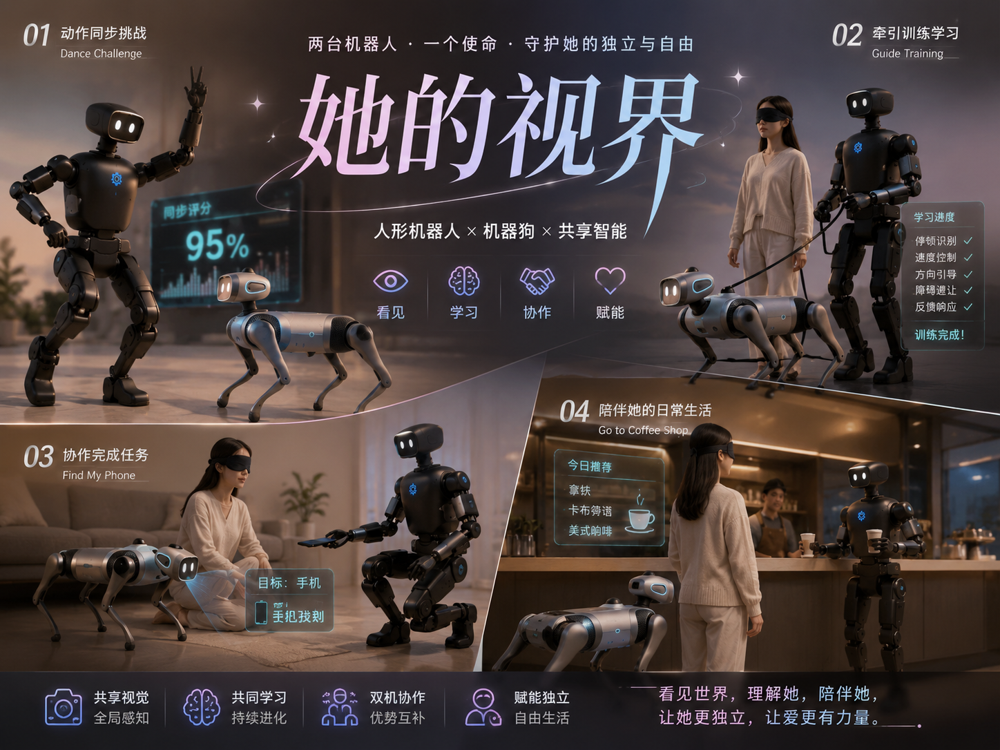
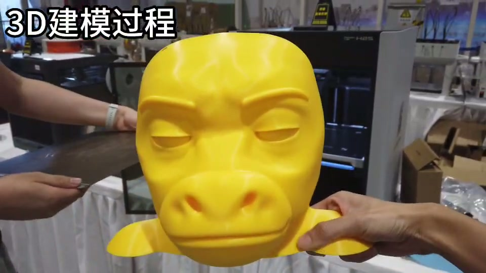
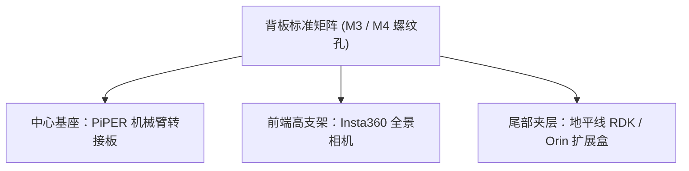

# 4.2 硬件改装、机械臂与外接算力板

> 🎙️ **【直播口播导语】**  
> *“从‘只会在地上走的四足狗’进化为‘能够抓取物品、检测隐患、协同操作’的**复合型机器人系统**，硬件外挂改装是必经之路！  
> 很多同学看到别人给机器狗装上机械臂端茶倒水、背上全景相机巡检，心里直痒痒，恨不得把市面上所有好玩的传感器和硬件一股脑全装上去！  
> 但四足机器人是靠动力学动态平衡活着的。背多重、重心怎么放、加装 PiPER 六轴机械臂怎么走 CAN 总线？  
> 本章将详细拆解背板机械孔位规范、3D 打印材质选型、CAN 总线加装 PiPER 六轴机械臂，以及扩展地平线 RDK / NVIDIA Orin 算力板的标准工程指南！”*

---

## 📸 多体协作与硬件外挂图景


*图 4-1：黑客松现场实拍：四足机器狗搭载外设与人形机器人同台多体协作*

---


*📸 实例：成型仓不足时把牛头拆成“前脸面具 + 后脑头盔”，用定位凸台与卡扣合体；头部外壳超约 400 g 会让前侧关节过载（详见 [4.3 CASE-03](4.3-hackathon-blueprints.md)）*


*📸 实例：完成外壳与服装装配的牛来芭比*

---

## 🖨️ 一、背板机械孔位与 3D 打印定制外壳

VBOT 狗背配备了通用的金属加强筋骨架与标准孔位阵列：



### 1. 3D 打印材质工艺建议
* **推荐材料**：**PETG** 或 **PA-CF（尼龙碳纤维）**。四足机器人在行走与小跑时机身存在持续高频振动，尼龙碳纤维兼具高刚性与抗疲劳韧性；
* **严禁材料**：普通的 **PLA** 在户外高温或持续震动下极易发生脆性断裂，导致高价值传感器坠地摔损。

---

## 🦾 二、背板集成 PiPER 六轴机械臂全流程

**松灵 PiPER 轻量化六轴机械臂**（自重约 3.8 kg，负载 1.5 kg）与 VBOT 5kg 的额定背板承重完美匹配，是黑客松与高校研发移动操作 (Mobile Manipulation) 的黄金搭档。

### 1. 供电引脚与电气规范
* **电压要求**：PiPER 机械臂工作电压为 **24V DC**，峰值瞬间电流可达 10A；
* **取电方案**：推荐通过背板专用的 24V 航空插头取电，或在机身内加装独立轻量动力电池组以避免机械臂大功率抽载拉低主板电压。

### 2. CAN 总线与串口通信打通
背板预留了标准 CAN 2.0B / CAN-FD 物理总线引出：
* **接口标识**：`CAN_H` 与 `CAN_L`，终端已集成 120Ω 匹配电阻；
* **主板使能（受权限约束）**：
  激活板载 `can0` 属于内核级网络接口配置，需要系统权限。**当前 1.6 固件的 `vbot` 账号未开放 `sudo`，开发者无法自行在计算主板上使能 CAN。** 下列命令仅作为官方/售后代配置，或后续固件开放相应权限后的参考写法：
  ```bash
  # 需系统权限：激活板载 can0 接口，设置波特率为 1Mbps
  sudo ip link set can0 type can bitrate 1000000
  sudo ip link set can0 up
  ```
* **当前权限模型下的两条落地路径**：
  1. **上位机接管总线（推荐）**：把 USB-CAN 适配器（CANable / PEAK / PCAN 等）接到外接算力板（RDK / Orin）或开发者笔记本上，由上位机完成 `can0` 使能与 PiPER 轨迹下发，机器狗只负责底盘运动与 24V 供电。整条链路不碰主板系统权限，是现在就能跑通的方案；
  2. **申请官方支持**：确需使用板载 CAN-FD 直连时，向官方提交工单，由官方在固件侧完成接口使能或开通对应权限，不要在文档与脚本里假设 `sudo` 可用。
* **控制联动**：总线打通后，通过松灵官方 ROS 2 功能包 `piper_description` 与 `piper_control`，可在持有 CAN 接口的那一侧（上位机或主板）发布关节轨迹规划包。

---

> 🎬 **实例：小安搜救机器狗**（Vbot + Insta360 X4 + RDK）演示视频
>
> <video src="../assets/videos/xiaoan-rescue-demo.mp4" controls width="560"></video>
>
> [点击观看 mp4](../assets/videos/xiaoan-rescue-demo.mp4) ｜ 详见 [4.3 CASE-06](4.3-hackathon-blueprints.md)

## 🖥️ 三、外挂地平线 RDK / NVIDIA Orin 算力板

当需要部署 7B 级别端侧视觉大语言模型时，可将外部算力板通过夹层无损固定在狗背：

### 1. 网络与数据流通讯
* 外部算力板与 VBOT 计算主板之间，推荐通过 **千兆以太网口直连**（配静态子网 `192.168.126.x`）；
* 算力板作为 ROS 2 客户端，直接订阅主板发布的 `/image_left_raw` 与雷达话题，推理出的控制决策再回传至 `/vel_cmd`，整机物理链路互不干涉。

### 2. 减震与散热
* 算力板与背板接触面必须加装 **硅胶减震阻尼球 (Damping Balls)**，过滤电机换向引起的高频共振；
* 算力板风扇进风口严禁被定制外壳遮挡，保持风道畅通。

在下一章 [4.3 黑客松标杆案例复盘（6大真实项目）](4.3-hackathon-blueprints.md) 中，我们将带你欣赏真实开发者如何运用这些改装方案夺得大奖！
