# 4.3 黑客松标杆案例复盘（6 大真实项目深度拆解）

> 🎙️ **【直播口播导语】**
> *“最好的学习方式不是看枯燥的 API 手册，而是看同行在真实高压场景下做出了什么！*
> *2026 年 8 月 26 日至 30 日，北京国家会议中心二期，SheNicest 千人黑客松。维他动力第一次把开发版机器狗交给了一群素未谋面的陌生开发者：3 台 EDU 开发版 + 5 台普通版，没有命题作文，只有赛前培训里反复说的一句话——**‘先让它动起来，再谈创意。’***
> *96 小时之后，6 个项目诞生：有在医院里陪患者走完全流程的聆灵，有让人愿意从沙发上爬起来的伽伽狗，有穿东北大花袄、戴大金链子的牛来芭比，有用 VLM + MCP 做健康感知的 PoopSense，有服务视障女性的她的视界，还有闯进废墟找人的小安。*
> *今天这一讲，我们把每个项目拆成：**痛点 → 架构 → 难点 → 可复用配方**，看完你就知道自己的创意该从哪里下手！”*

---

## 📊 赛事全景与 6 大项目速览

| 维度 | 信息 |
| :--- | :--- |
| 活动 | SheNicest 2026 烈变黑客松（北京·国家会议中心二期） |
| 时间 | 2026.08.26 — 08.30（约 96 小时，实际写代码窗口 48~72 小时） |
| 规模 | 报名约 1000 人，到场约 500 人 |
| 设备 | 3 台 Vbot EDU 开发版 + 5 台普通版 |
| 产出 | 6 个完整二开项目；找零零队“聆灵”获**维他动力创造奖** |
| 开箱 SOP | 逐台 SSH 连入 → 逐台 `/vel_cmd` 点动测试 → 确认“听得懂话”才交付选手 |

| # | 项目 | 团队 | 赛道 | 核心技术栈 | 一句话 |
| :-- | :--- | :--- | :--- | :--- | :--- |
| 01 | **聆灵 Linbot** 🏆 | 找零零队 | 医疗陪诊 | 语音理解 + 导航 + 防跟丢 + AED 药篮 + 视觉哨兵 | 谁来陪她走完整个就医流程？ |
| 02 | **伽伽狗 YogaGo** | 汪汪队 | 居家运动 | YOLO-Pose + Sherpa 自定义唤醒词 + 动作编排 | 不是教练，是愿意陪你开始的搭子 |
| 03 | **牛来芭比 MooBie** | 抢地牛来队 | IP 实体化 | 3D 打印 + 大模型情绪计算 + 动作基语 | 让牛来走出荧幕 |
| 04 | **PoopSense** | PoopSense 队 | 智能家居/健康 | 自研感知模块 + AI Agent + 机器狗执行终端 | 无感健康感知的实体执行终端 |
| 05 | **她的视界** | 软硬兼施队 | 无障碍辅助 | 机器狗 + 人形机器人 + 全局摄像头 | 多体协作服务视障女性 |
| 06 | **小安 Life Rescue** | — | 应急救援 | Insta360 X4 + RDK + 多模态 AI + 指挥界面 | 360° 搜救，回传“先救谁” |

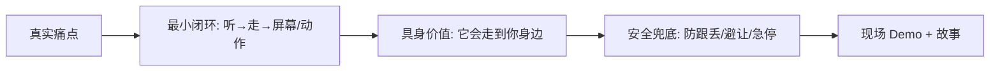

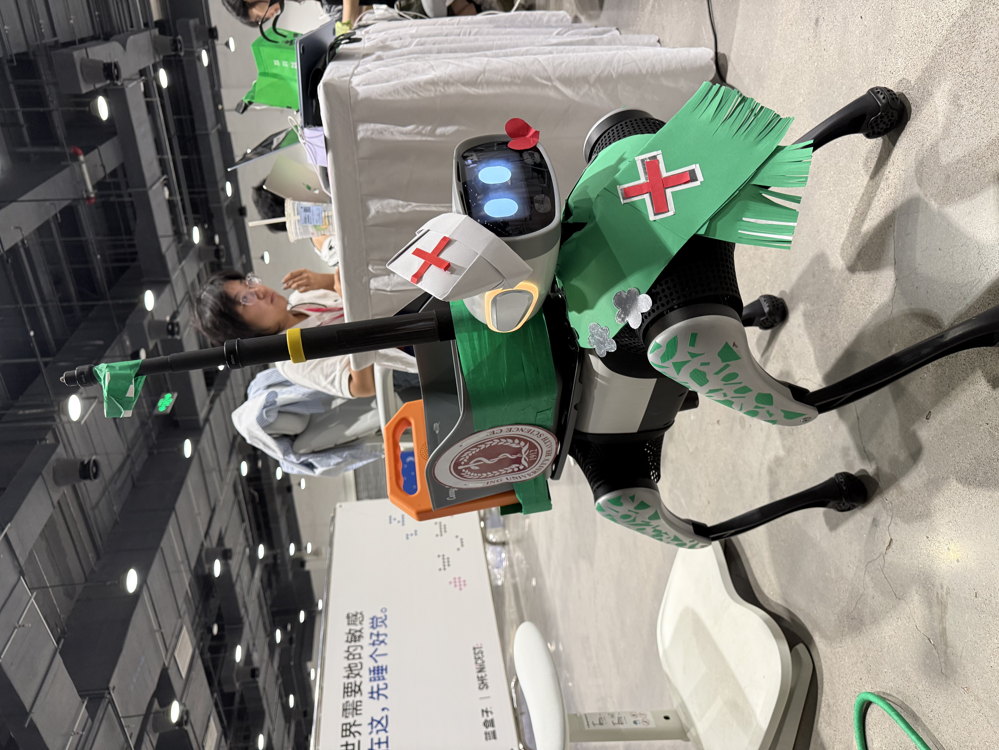
*图 4-1：SheNicest 黑客松现场，聆灵与选手同框*

> 💡 **【学员互动】** 弹幕提问：你觉得评委为什么把创造奖给了一个“没有炫技”的陪诊项目？（答案在 CASE-01）

---

## 🏆 CASE-01 聆灵 (Linbot)：医院陪诊机器狗（维他动力创造奖）

* **团队**：找零零队（队长佳一；核心二开萝卜·韩宛吟；硬件改装美诗；涂装与视觉 Eason、不凡）——赛前互不相识，在选手群“拼车”组队；
* **开发时间**：**48 小时**（前 48 小时推翻了一个“伪需求”方案）；
* **一句话定位**：*“她解决的不只是‘科室在哪里’，而是：当一个人走进医院，谁来陪她完成整个就医流程？”*
* **外部链接**：[Linbot 官网](https://linbot-iota.vercel.app/)

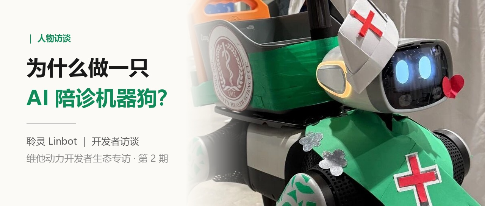
*图 4-2：聆灵推文封面海报*

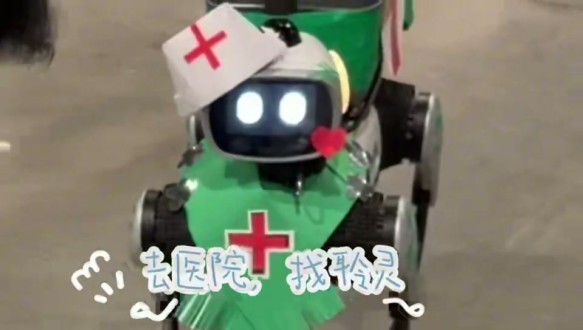
*图 4-3：头戴红十字护士帽、脸颊贴红色爱心的聆灵 —— “去医院，找聆灵～”*

### 🎬 实机演示视频

<video src="../assets/videos/linbot-demo-0f0f.mp4" controls width="640"></video>

👉 [点击观看：聆灵陪诊实机演示（mp4，约 8.4MB）](../assets/videos/linbot-demo-0f0f.mp4)

| 时间轴 | 看点 | 对应小节 |
| :--- | :--- | :--- |
| 1:20 – 1:55 | 顶置摄像头运行 `basket-sentry`，盘点药篮与拿取记录 | 药篮与视觉哨兵 |
| 2:00 – 2:15 | 深夜“蓝盒子睡眠区”模拟突发胸痛，呼叫聆灵四足疾驰赶到 | 应急演练 |
| 2:15 – 2:25 | 施救者取下 AED，现场贴除颤电极贴片 | 应急演练 |

### 1️⃣ 需求从哪来：母亲的一句话，推翻 48 小时的伪需求

- 团队前 48 小时一直在做美诗带来的产品构想，越推越觉得是“为了比赛硬凑的伪需求”，**自己都说服不了**；
- 第二天下午，萝卜转述了妈妈去大医院看病的真实痛点：医院像迷宫，挂号在 A 区、抽血在 B 区、CT 在负一层；固定导诊屏“看完转两个弯就忘”；
- 全队一致决定：**哪怕只剩 48 小时，也推翻重来**；决定后的第一分钟，队长就去向组委会申请 EDU 真机——*“不接真机调试，所有设计都只是纸上谈兵。”*

> 🧠 **复盘心法**：黑客松里最怕“既要讲宏大故事，手里又没有能跑的 Demo”。**先拿真机，再做设计。**

### 2️⃣ 48 小时分工：多线程并行

| 角色 | 职责 |
| :--- | :--- |
| 萝卜 + 不凡 | 底层 SDK 与软件二开：信令、建图、导航规划 |
| 美诗 | 硬件改造：支架、AED 急救模块承托、摄像头走线 |
| 佳一 + Eason | 视觉识别、产品交互逻辑、全套物理涂装（护士帽、披风、腿部几何花纹） |

### 3️⃣ 五大功能链路：把陪诊收敛成一个技术闭环

团队先把患者行为拆成两类：**确定性刚性任务**（挂号、就诊、化验、取药）与**突发性弹性需求**（上洗手间、走累想坐下、突发急救），据此收敛成五大功能：

1. **线上预约与远程迎宾**：到达前对齐挂号信息，大厅指定点位迎宾并确认身份；
2. **全流程路径规划导航**：按就医 SOP 把科室串成最优路线，主动领路；
3. **动态任务中插**：主路径中允许患者随时插播“去洗手间 / 打印化验单”等支线，完成后无缝回归主线；
4. **紧急医疗响应（AED 联动）**：背负真实 AED 应急装置，一键切入紧急向导/报警；
5. **任务完成自动归位**：陪诊结束引导离院，自主回桩充电待命。

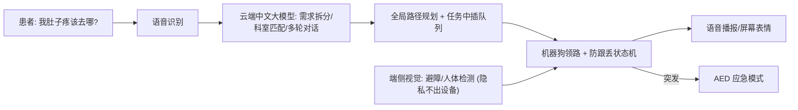

### 4️⃣ 防跟丢状态机：“主人，你在哪？”

> 在真实医院里，**跟丢不是异常，而是必然**。技术必须适应人，而不是强求虚弱的患者追赶机器。

| 状态 | 触发条件 | 机器狗行为 |
| :--- | :--- | :--- |
| **引路** | 患者距离 ≤ 2.5 m | 匀速在前引路，保持稳定步态 |
| **警戒** | 2.5 m < 距离 ≤ 3 m | 降速、频繁回望 |
| **驻足** | 距离 > 3 m 且持续 > 2 s | **立刻停步原地等待**，转向并语音：“主人，你在哪？” |
| **恢复** | 距离回到 ≤ 2.5 m 且持续 > 1 s | 恢复带路巡航 |

```python
# 防跟丢状态机参考实现（示意，复用 1.2 / 2.3 的 /vel_cmd 安全骨架）
from enum import Enum, auto


class State(Enum):
    GUIDE = auto()
    WARN = auto()
    WAIT = auto()


class FollowGuard:
    SAFE, LOST, LOST_HOLD, BACK_HOLD = 2.5, 3.0, 2.0, 1.0

    def __init__(self) -> None:
        self.state = State.GUIDE
        self._lost_since: float | None = None
        self._back_since: float | None = None

    def update(self, dist: float, now: float) -> State:
        if self.state != State.WAIT:
            if dist > self.LOST:
                self._lost_since = self._lost_since or now
                if now - self._lost_since >= self.LOST_HOLD:
                    self.state = State.WAIT
                    self._back_since = None
            else:
                self._lost_since = None
                self.state = State.WARN if dist > self.SAFE else State.GUIDE
        else:
            if dist <= self.SAFE:
                self._back_since = self._back_since or now
                if now - self._back_since >= self.BACK_HOLD:
                    self.state, self._lost_since = State.GUIDE, None
            else:
                self._back_since = None
        return self.state

    def speed(self) -> float:
        """WAIT 状态必须下发零速度，其余状态由导航器决定。"""
        return {State.GUIDE: 0.4, State.WARN: 0.2, State.WAIT: 0.0}[self.state]
```

### 5️⃣ 背上的两套系统：AED 急救箱 + 智能药篮 / 视觉哨兵

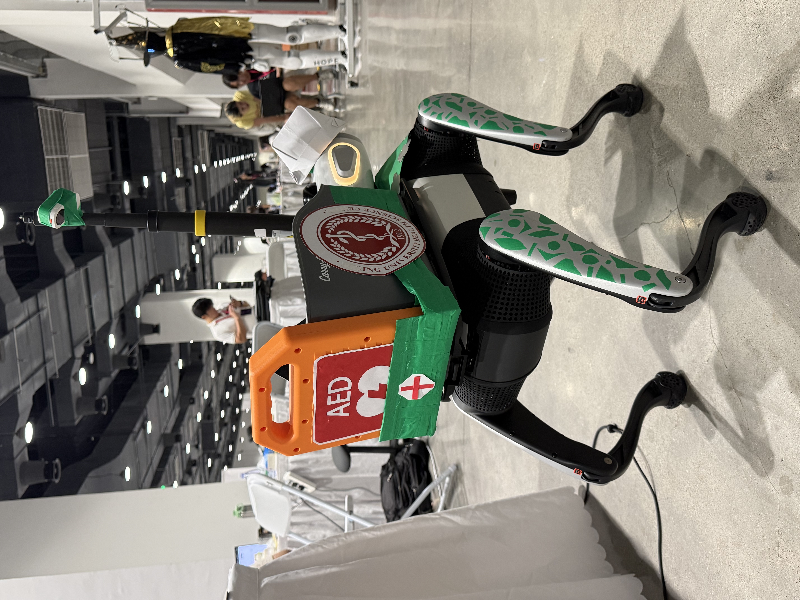
*图 4-4：后背挂载的橙色 AED 应急医疗箱与高位延伸视觉支架*

- **具身的物理价值**：软件只能告诉你“AED 在 200 米外的柱子后面”；而在黄金 4 分钟里，**背着 AED 走在走廊里的机器狗本身就是移动急救单元**；
- **智能药篮（五色分区）**：

| 颜色 | 药品 | 应对场景 |
| :-- | :-- | :-- |
| 🟢 绿 | 肾上腺素自动注射器 | 急性严重过敏 |
| 🟡 黄 | 口服葡萄糖片 | 突发低血糖昏厥 |
| 🔴 红 | 阿司匹林咀嚼片 | 急性心绞痛/心梗 |
| ⚪ 白 | 沙丁胺醇吸入剂 | 哮喘急性发作 |
| 🔵 蓝 | 纳洛酮鼻喷雾 | 阿片类药物急性中毒 |

- **视觉哨兵 `basket-sentry`**：高位延伸杆上的俯视广角摄像头 + 本地轻量目标检测。判定规则极简而鲁棒：**“整幅画面即篮子，离屏 1 秒即视为拿出”**，终端播报“刚拿：口服葡萄糖片，累计拿取 4 次”，自动完成用药审计。

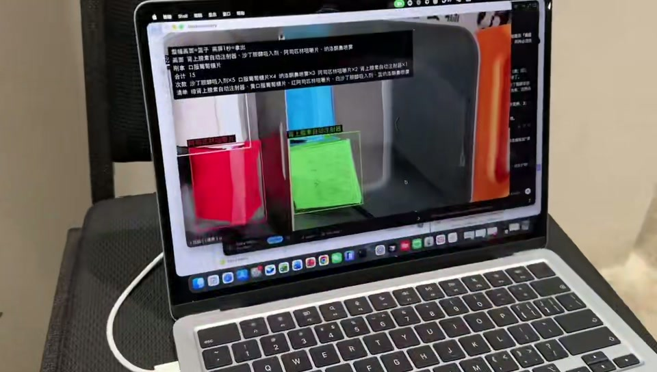
*图 4-5：顶置摄像头运行 basket-sentry，实时盘点药篮与拿取记录*

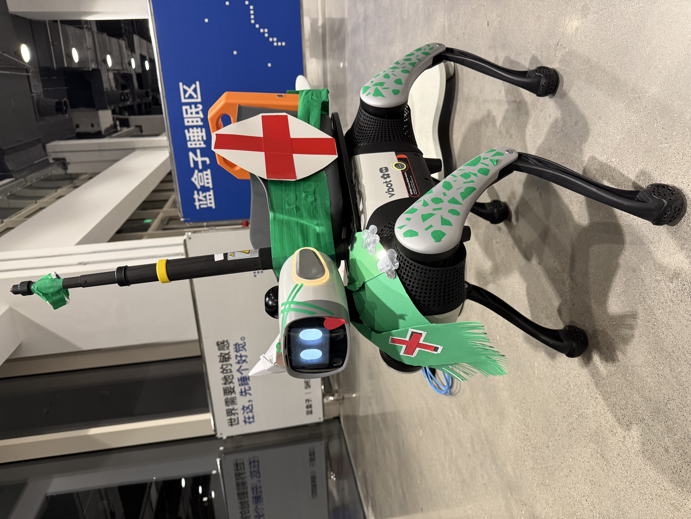
*图 4-6：机身 Vbot 标识、定制十字徽章与前脸表情交互屏*

> ⚠️ **工程约束对照**：药篮 + AED + 摄像头支架的总重必须落在 [4.1](4.1-specs-and-constraints.md) 的 **5 kg 额定负载**内，并保证质心居中。

### 6️⃣ 深夜 2 点的“急救实战演练”

最后一天凌晨两点，团队在“蓝盒子睡眠区”自导自演：同伴“突发胸痛倒地”，队友喊出——*“有 T 恤吗？没有！有聆灵！呼叫聆灵！”* 聆灵四足小跑疾驰而至，施救者从后座取下 AED、撕开电极贴片贴胸除颤，并从药篮取出阿司匹林/葡萄糖。

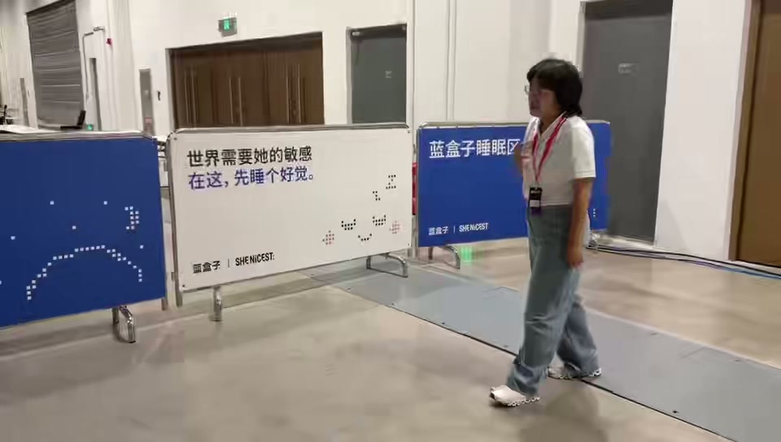
*图 4-7：视频 2:00–2:15，聆灵四足疾驰赶赴现场*

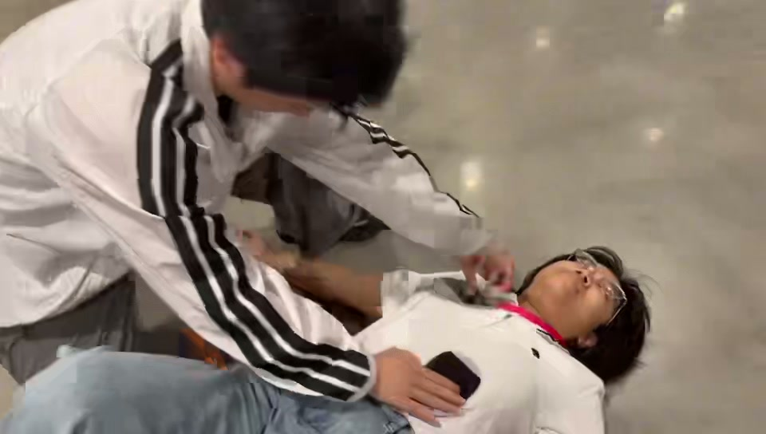
*图 4-8：视频 2:15–2:25，现场实施除颤贴片施救*

> 这段演示证明：它不只是“带路狗”，而是**兼备感知、物资运送与应急干预的移动生命保障底盘**。

### 7️⃣ 嘈杂医院的现实：语音不够，要“被拍拍头”

- 医院大厅叫号声、家属交谈、推车滚轮混杂，**远场麦克风唤醒误触/漏识率高**；
- 改进思路：① 手机小程序 + 耳机近场语音输入，机器狗只做物理执行；② **触觉/手势交互**——轻拍头部或背部传感器即“坐下/确认”；
- **端云分工**：EDU 端侧 **128 TOPS** 跑视觉感知（低延迟避障、人脸/人体检测 + **医疗隐私合规**，图像不外传）；云端中文大模型负责就医流程推理、科室问答、多轮对话与全局规划。**端侧保隐私与响应，云端保认知与决策。**

### 8️⃣ 城乡规划学的“空间补集”视角

- 萝卜（同济大学城乡规划学）先用 **2.5 维方式预录了楼层与电梯结构**；
- 洞察：多数语义建图在拼命识别“实体”（墙、柱、柜），但**空间真正为人所用的，是被实体“空出来”的补集——通道与开敞负空间**；
- 在高动态医院里，要理解“推车从哪过、人流常态流向、哪片留白适合避让”，对空间补集建立概率描述，通行效率与优雅度会质变。

### 9️⃣ 可复用工程经验（结合 EDU 约束）

1. **算力隔离防摔机**：大模型/视觉高负载时用 `taskset -c 2-7` 把 AI 进程限定在 CPU 2–7，给 `locomotion_exec` 保留 0–1 核，杜绝看门狗超时（见 [5.2](../05-diagnostics-faq/5.2-safety-and-guardrails.md)）；
2. **定位退化自愈（参考方案）**：高抛光地砖镜面反射会让激光点云噪点增多、Nav2 定位粒子发散；可在定位方差超标时触发“原地小角度慢速旋转”以捕捉墙面特征并重定位；
3. **外设扩展**：背部药篮/AED 走机械接口，面部大头屏切换导诊二维码与护士表情；
4. **长期主义**：团队赛后未解散，目标是在杭州/深圳争取一家医院的真实试点——*哪怕只开放服务台到检查室几百米动线。*

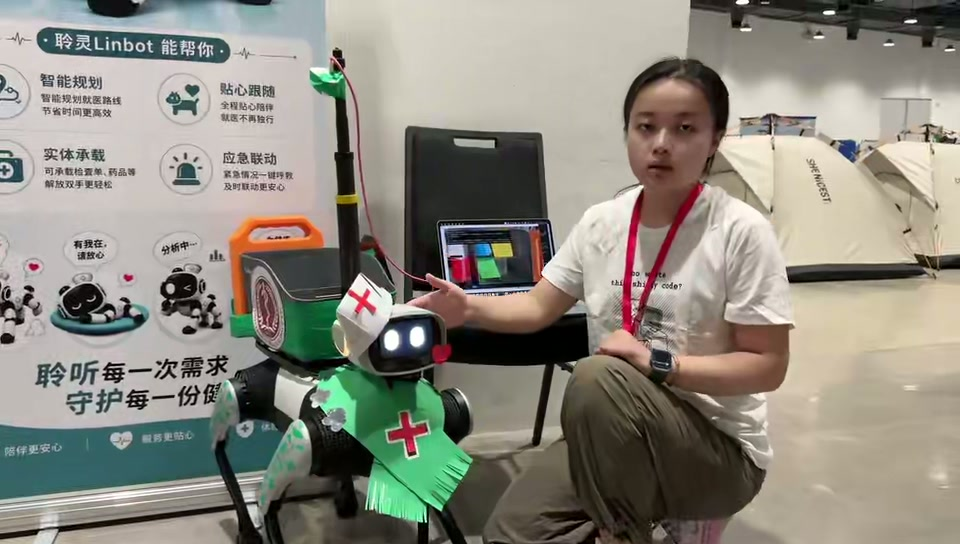
*图 4-9：找零零团队与聆灵展台——聆听每一次需求，守护每一份健康*

---

## 🧘 CASE-02 伽伽狗 (YogaGo)：具身智能瑜伽搭子

* **团队**：汪汪队（艾奕芊：港大法律与媒体方向博士退学转 AI；王晨宇：港中文数学系 PhD，本科飞行器设计）——**两人此前都没做过具身智能项目，三天完成**；
* **平台**：大头 EDU 版，戴毛绒耳朵与尾巴；
* **一句话定位**：*“我们想做的不是冷冰冰的瑜伽教练，而是一个具身的瑜伽搭子。”*

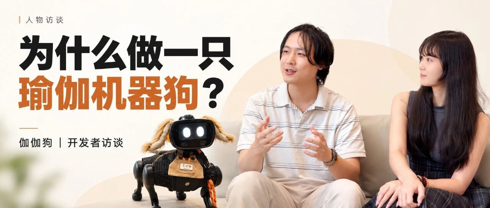
*图 4-10：YogaGo 设计理念——成为有温度的居家运动陪伴搭子*

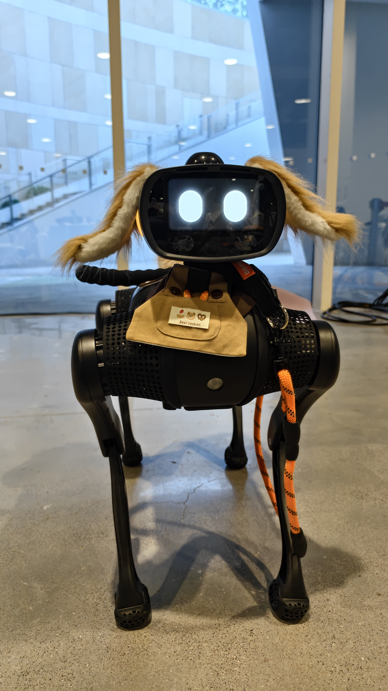
*图 4-11：现场的伽伽狗，毛绒耳朵与尾巴让观众和小朋友主动靠近*

### 1️⃣ 为什么是“搭子”，不是“教练”

- 真小狗有陪伴感但没法提醒/模仿你；机器狗刚好把“陪伴感 + 功能性”连起来；
- 痛点不是“不知道怎么练”，而是**“人知道，但不想开始”**——它先解决的是“让你愿意起来”；
- 手机健康提醒会被顺手划掉，闹钟会被按掉，但**一个会走到你身边的实体，你伸手摸它一下，就脱离“继续躺着”的惯性**。

### 2️⃣ 三天最难的一课：功能会互相冲突

- 视觉识别、运动控制、语音唤醒、大模型对话、物理安全并发——这是**多模块并发的活体系统**；
- 真实踩坑：云端大模型接入对话后，**本地控制指令与大模型触发机制产生死锁，机器狗直接不动**。“A 单独好，B 单独好，A+B 全是 bug”；
- 取舍：三天内砍掉大量想法，优先保证 **核心动作识别、基本避障、专属名字**。

> 🧰 **配方对照**：并发冲突请回到 [3.1](../03-embodied-agent/3.1-motion-control-and-rcp.md) 的“直接速度控制 vs RCP 二选一”铁律，并为动作加上**打断与超时保护**，优先级：安全停机 > 用户打断 > 动作响应 > 闲时随机“活力动作”。

### 3️⃣ 技术拆解

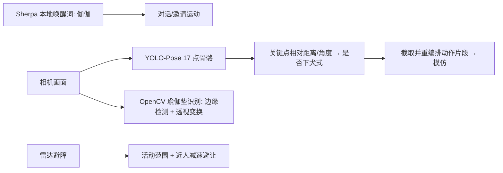

1. **姿态判定**：YOLO-Pose 提取肩/胯/头/四肢关键点，依据相对距离与角度判断下犬式/类俯卧撑姿态；
2. **骨骼置信度**：官方原始输出为 Logit，须做 Sigmoid 还原为 $[0,1]$ 概率（见 [3.2](../03-embodied-agent/3.2-perception-data-streams.md)）；
3. **关节夹角**（以膝关节为例，B 为顶点）：

$$\theta = \arccos\left(\frac{\vec{BA}\cdot\vec{BC}}{|\vec{BA}||\vec{BC}|}\right)\times\frac{180^\circ}{\pi}$$

```python
import math


def sigmoid(logit: float) -> float:
    return 1.0 / (1.0 + math.exp(-logit))


def joint_angle(a: tuple[float, float], b: tuple[float, float], c: tuple[float, float]) -> float:
    """b 为顶点，返回 ∠ABC（度）。"""
    bax, bay = a[0] - b[0], a[1] - b[1]
    bcx, bcy = c[0] - b[0], c[1] - b[1]
    denom = math.hypot(bax, bay) * math.hypot(bcx, bcy)
    if denom == 0:
        raise ValueError("退化关键点：向量长度为 0")
    cos_t = max(-1.0, min(1.0, (bax * bcx + bay * bcy) / denom))
    return math.degrees(math.acos(cos_t))
```

4. **动作模仿**：动作库里的现成动作不一定刚好合适（有的连续、有的只有静态姿势），团队**截取片段重新编排**，让肢体语言“像在模仿你”；
5. **安全第一**：现场有很多小朋友——划定明确活动范围，识别到人距离过近**立即避让减速**；
6. **雷达看不见平铺的瑜伽垫 → 交给视觉**：从俯视角度做边缘检测与透视变换（OpenCV，由 Agent 起草基础版再按实机调参）。

### 4️⃣ “看得见远处，看不见脚下”的硬件盲区


*图 4-12：现场动作演示（下犬式）*

- 机器狗视角低，人趴在垫子上后会**从视野里“消失”**；
- 解法：让它**后退、低头、身体前倾**，从不同视角观察地面，并**融合不同距离的识别结果**，不因某一帧没看清就判定人不见；
- 意外收获：这个补盲动作看起来**很像一只狗低头凑过来看你在干嘛**——工程约束反而变成了拟人化交互。

### 5️⃣ “伽伽”：唤醒词是关系的开始

- 团队把唤醒词改成“伽伽”：*给宠物起名字，它和你的关系就变了*；
- 底层唤醒代码无权限直接修改，于是**绕开写死的唤醒链路，在外部重新接管音频流**，用 **Sherpa** 在本地电脑提取“伽伽”的语音特征并匹配后触发响应；
- 局限：训练与测试主要用自己的声音，换人偶尔不灵敏——“更认主人”；
- 完整的唤醒词替换与音频截流方案见 [3.3](../03-embodied-agent/3.3-ai-native-multimodal.md)。

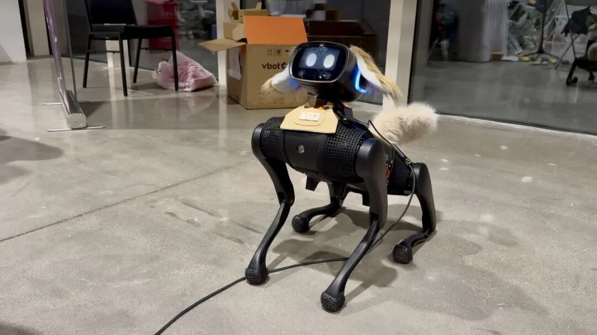
*图 4-13：现场动作演示（直立站姿）*

### 6️⃣ Agent 时代，开发者的价值在哪

- 大量使用 Agent 生成图像处理管道、测试脚本与接口骨架；
- 但**先自己摸清机器边界**：相机视角多宽、动作响应延迟多少、哪些接口能调——再给 Agent 恰当上下文；
- 王晨宇的结论：*“它比想象的更像一个系统问题——感知、动作、安全、延迟在物理约束下怎么互相妥协。”*

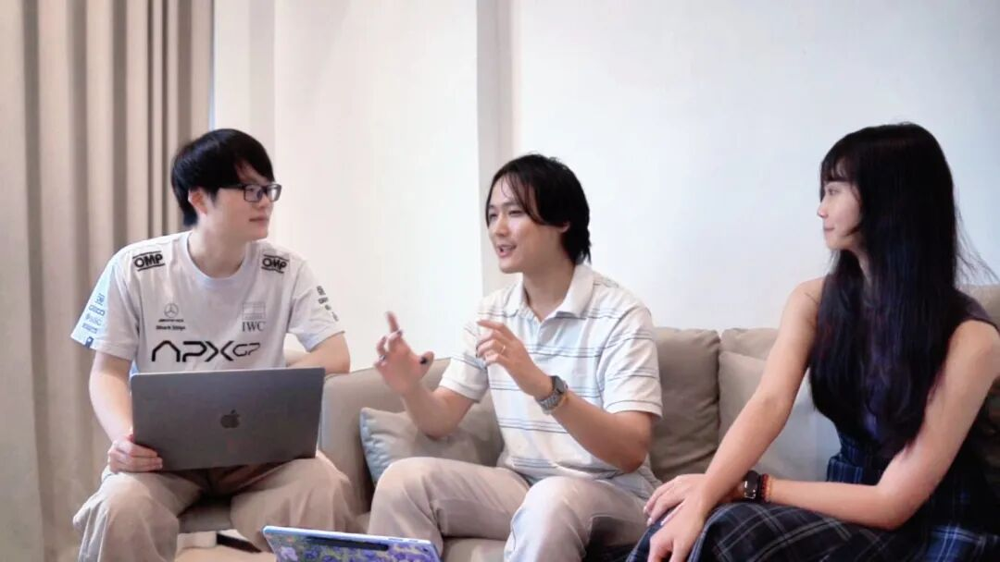
*图 4-14：赛后访谈现场（王晨宇、张振尧、艾奕芊）*

> 💡 **【学员互动】** 你的创意里，哪两个功能最可能互相“打架”？现在就写下它们的优先级表。

---

## 🎨 CASE-03 牛来芭比 (MooBie)：让牛来走出荧幕

* **团队**：抢地牛来队（队长兼硬件结构辛瑞莉；大模型/提示词、全栈集成、产品、视觉 UI，共 5 人），96 小时封闭开发；
* **一句话定位**：*“芭比的内核是 You can be anything——那‘牛来’为什么不能是一只四足机器狗？”*
* **在线体验**：[小牛来桌宠](https://mpos-robot-studio.pages.dev/)

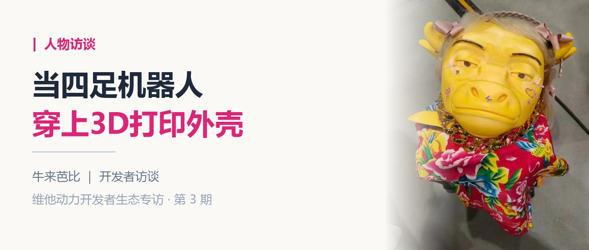
*图 4-15：牛来芭比核心视觉封面*

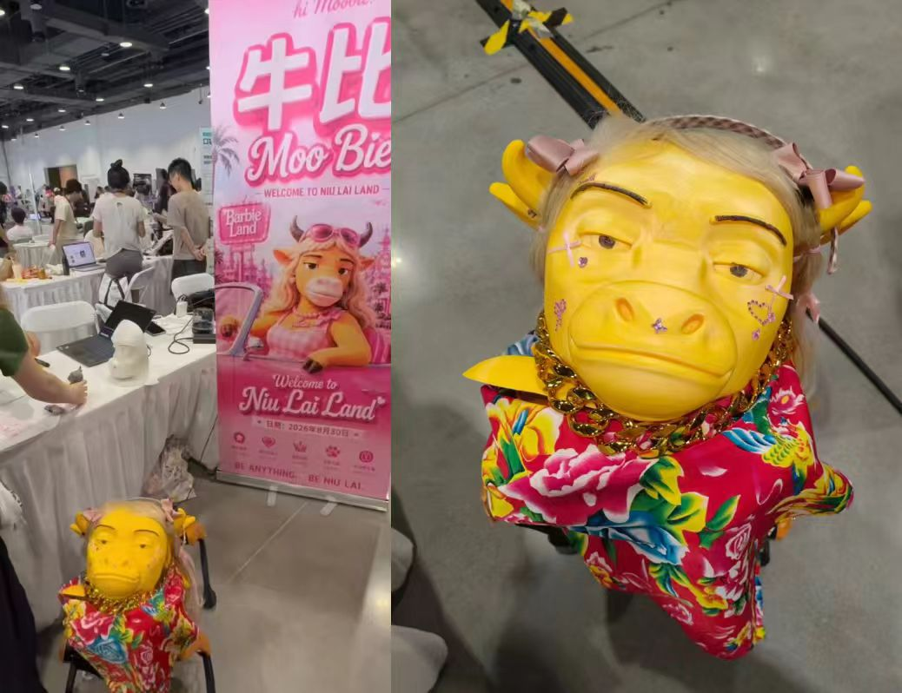
*图 4-16：粉色 Barbie 风格展台与静卧待命的牛来芭比*

### 🎬 路演演示视频

<video src="../assets/videos/moobie-demo-show.mp4" controls width="640"></video>

👉 [点击观看：牛来芭比展示视频（mp4，约 18MB）](../assets/videos/moobie-demo-show.mp4)

### 1️⃣ “一魂多身”产品矩阵

| 模块 | 形态 | 能力 |
| :--- | :--- | :--- |
| 牛来芭比四足机器狗 | 3D 打印外壳 + 服装 | 大空间漫游、跟随、迎宾、肢体互动 |
| 小牛来桌宠 | 桌面轻量机器人 | 网页输入自然语言（“跳个开心的舞”）→ 大模型生成姿态代码 → 驱动舵机，支持多轮对话 |
| 牛牛来了·声音盲盒机 | 麦克风 + 投屏 | 说一句话 → 语义/情绪识别 → 生成“名画风/电影风/幸运色”牛牛画作，扫码分享 |

### 2️⃣ 结构工程通宵救火：当 3D 打印撞上物理极限


*图 4-17：从打印机热床取出的分体姜黄色牛脸外壳结构件*

1. **问题**：牛头必须完整包裹原装头部模块与屏幕，同时留出散热、传感器视场与颈部自由度；切片软件直接报警——**成型仓尺寸不够**；整头一体打印耗时超 24 小时且一旦翘边断料全盘报废；
2. **解法**：CAD 中拆成**“前脸面具 + 后脑头盔”**，接缝处设计定位凸台与卡扣槽，物理卡扣 + 热熔胶合体；
3. **代价**：前脸约 10 小时，后脑约 8 小时，两天两夜每半小时盯一次首层附着力；
4. **重量红线**：头部外壳**超过约 400 g，快走/抬腿时前侧关节会过载抖动**，必须掏空与网格减重（对应 [4.1 负重与质心约束](4.1-specs-and-constraints.md)）。

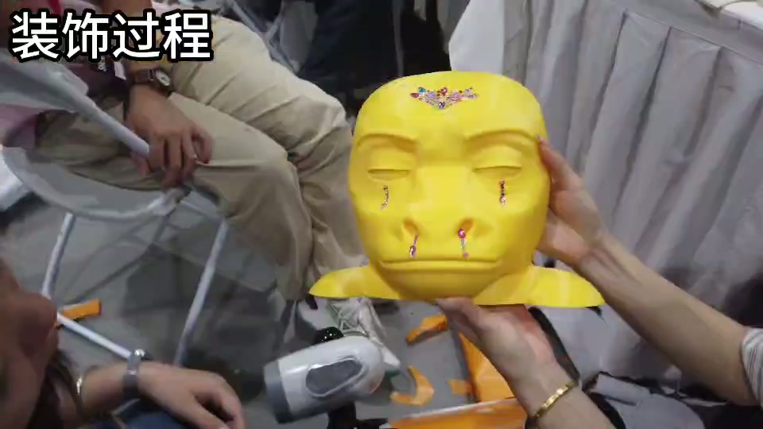
*图 4-18：凌晨工位，手工粘贴闪钻泪痕、鼻环与睫毛*

> **后处理清单**：凌晨四点砂纸打磨 PLA 层纹 → 丙烯勾眼线眼影嘴角 → 粉色闪钻“泪痕”、额头小皇冠、粉色锆石“牛鼻环” → 金发双马尾假发用扎带+热熔胶固定后脑壳 → 东北大红大绿花布按背部接口与四肢运动包络线现场剪裁缝制。

### 3️⃣ 软硬件融合：五环节情绪计算链路


*图 4-19：完成装配与服装穿戴的牛来芭比挺胸站立*

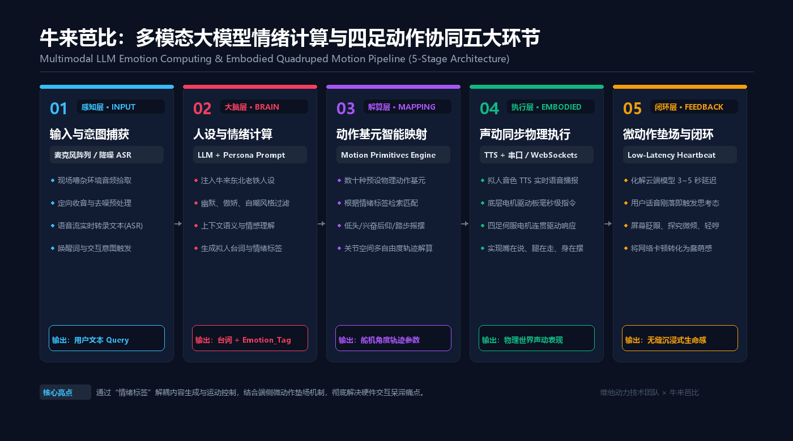
*图 4-20：多模态大模型情绪计算与四足动作协同五大环节技术架构*

闭环：**多模态输入 → 情绪与语义理解 → 拟人化动作生成 → 物理执行**。对应 EDU 实现：语音识别 → 意图/剧本推理 → 情绪标签降解 → 动作基语/RCP DAG 编排 → 声光屏表情并发执行（见 [3.1](../03-embodied-agent/3.1-motion-control-and-rcp.md)）。

### 4️⃣ 化解 3~5 秒大模型延迟：“微动作垫场”

- 现场 Wi-Fi 拥堵时，语音 → 文本+动作指令往返需 **3~5 秒**；机器狗僵住 5 秒，人会立刻觉得“坏了”；
- **垫场机制**：检测到语音结束，**不等云端返回**，立刻触发随机“倾听状态”——头部微扬、重心轻后倾、屏幕眼睛快速眨动、一声“嗯？”——云端回来后再接傲娇方言 + 点头踏步；
- 卡顿因此变成“蠢萌反射弧”。

```python
import random
import threading
from typing import Callable


def respond_with_filler(
    play_filler: Callable[[str], None],
    ask_cloud: Callable[[], dict],
    execute: Callable[[dict], None],
    timeout_s: float = 8.0,
) -> None:
    """语音结束后立即垫场，云端结果到达后再执行；超时则保持倾听姿态并放弃。"""
    result: dict = {}
    done = threading.Event()

    def _worker() -> None:
        result.update(ask_cloud())
        done.set()

    threading.Thread(target=_worker, daemon=True).start()
    play_filler(random.choice(["listen_tilt", "blink_fast", "hmm_sound"]))
    if done.wait(timeout_s):
        execute(result)
    else:
        play_filler("apologize_shrug")  # 有界等待：绝不无限卡死
```

### 5️⃣ 为什么大人抢着戴牛头面具

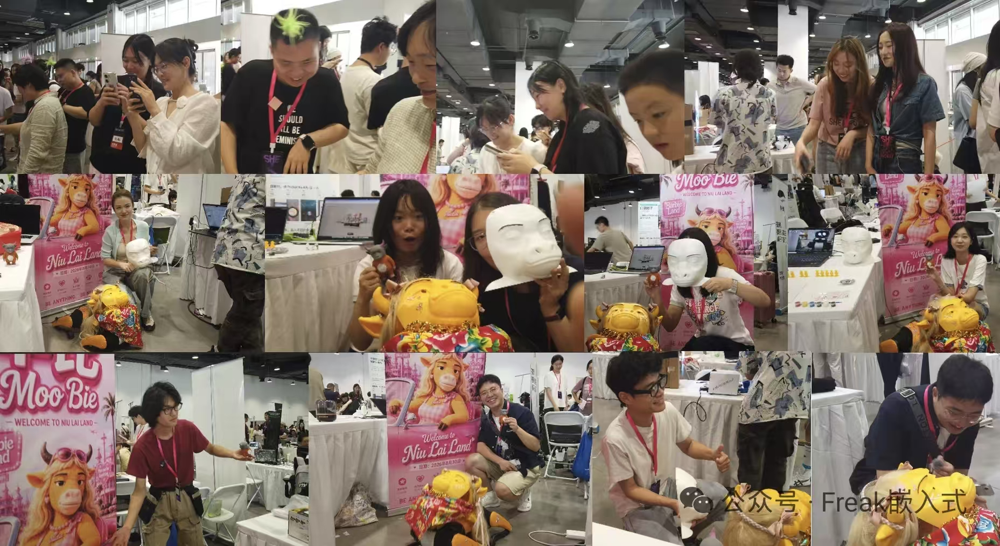
*图 4-21：投资人、工程师、评委争相试戴 3D 打印牛脸面具合影*

- 套上金发、牛头、金链、花袄的一刻，**技术的神圣感与距离感被消解**；
- 戴面具自拍是一种**“自我解放”**——短暂逃离成年人的专业面具；
- 结论：**情绪价值不是副产物，而是消费级硬件敲开大众心门的通行证。**

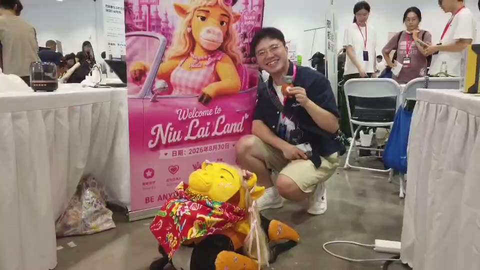
*图 4-22：团队成员手持小牛来原型与展板合影*

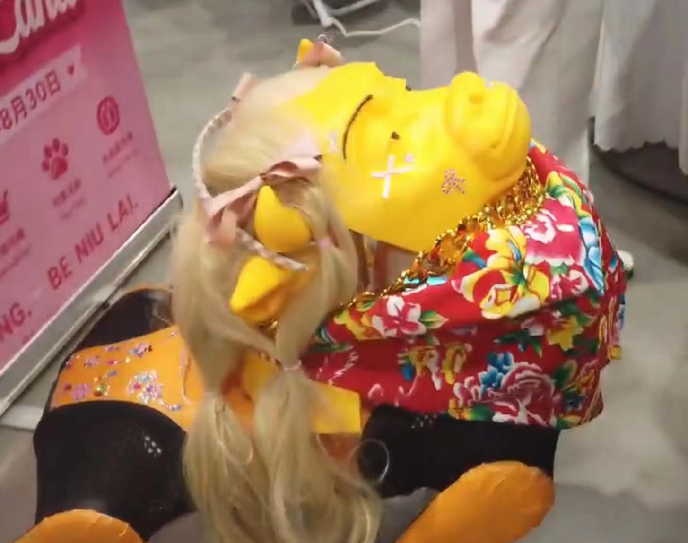
*图 4-23：金色卷发双马尾、粉红缎带、金链与花袄面料细节*

### 6️⃣ IP 具身化三层解构模型（可直接套用）

| 层级 | 核心任务 | 工程落脚点 | 踩坑与建议 |
| :--- | :--- | :--- | :--- |
| **L1 皮囊层** | 视觉辨识度与机械适配 | 3D 打印外壳、卡扣公差、面料、质心 | 头部外壳 >400 g 前舵机过载；必须掏空减重；避开雷达/双目光锥并预留散热风道 |
| **L2 灵魂层** | 人设、语料、情绪基准 | System Prompt、少样本、情绪标签 | 别做百科问答；赋予“嘴硬心软、幽默自嘲”的脾气 |
| **L3 具身层** | 声动合一、空间感知、微表情 | 动作基语字典、屏幕联动、防死锁调度 | 建立打断与超时保护；优先级：安全停机 > 用户打断 > 动作响应 > 闲时游荡 |

> 🗣️ **给本体厂商的建议**：把机身外部机械扩展接口与外壳挂载点**标准化**（螺孔、滑轨、低压供电），让创作者像“换手机壳”一样给机器狗换皮卡丘头、高达外甲、牛来芭比。

---

## 🏠 CASE-04 PoopSense：家庭健康的无感感知入口

* **团队**：PoopSense（队长庞雅心）｜**赛道**：智能家居 / 无感健康监测
* **使用产品**：Vbot 大头机械狗 + 自研感知模块 + AI Agent
* **现场一句话**：*“最私密的信号，交给最不打扰的执行者。”*

> 📼 **演示视频**：原片约 74 MB（`03-黑客松与合作/SheNicest/PoopSense/微信视频2026-09-03_212844_325.mp4`），为控制 `vbot-docs` 仓库体积**未随文档库打包**；独立分支需要时请自行放入 `assets/videos/poopsense-demo.mp4` 并在此处补链接。

### 架构：感知 → 理解 → 执行 三段式

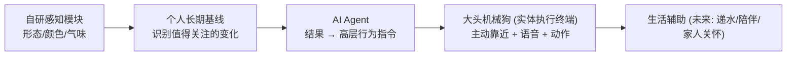

| 层 | 职责 | 对应 EDU 能力 |
| :-- | :-- | :-- |
| 感知 | 采集分析，形成身体状态信号 | 外部模块，经网络/总线接入 |
| 理解 | Agent 把检测结果转成高层指令 | 对接 [3.3 MCP 服务](../03-embodied-agent/3.3-ai-native-multimodal.md) 暴露的工具 |
| 执行 | 靠近用户、语音与动作提醒（如“近期偏干 → 提醒补水”） | `/vel_cmd` 受限移动 + [RCP 动作编排](../03-embodied-agent/3.1-motion-control-and-rcp.md) |

> 🧠 **复盘心法**：*感知交给传感器，理解交给 Agent，温度交给机器狗。* 把机器狗定位为智能家居的**“人体状态感知入口”之执行端**，而不是什么都自己做。
>
> ⚠️ 涉及健康隐私的数据应优先**端侧/本地处理**，参考聆灵的“端侧保隐私、云端保认知”分工。

---

## 👁️ CASE-05 她的视界：视障女性的智能伙伴

* **团队**：软硬兼施队（队长张玄昱）｜**赛道**：无障碍辅助
* **使用产品**：Vbot 机器狗 + 人形机器人 + 全局视觉摄像头（双目视觉）
* **演示视频**：[B 站 BV1aJ4Q6vEhc](https://www.bilibili.com/video/BV1aJ4Q6vEhc/)


*图 4-24：机器狗 + 人形机器人 + 全局摄像头的多体协作场景*

- **问题**：视障人士需要的不是“被安排好的生活”，而是**一个能一起探索世界的伙伴**；
- **三方分工**：

| 角色 | 职责 |
| :-- | :-- |
| 机器狗 | 移动探索与环境感知 |
| 人形机器人 | 交互、操作与任务执行 |
| 全局摄像头 | “第三只眼”——共享视觉与空间理解 |

- **四大场景**：动作同步挑战 → 引导训练 → 协作寻找物品 → 日常出行陪伴；
- **立意**：*技术不是替视障女性做决定，而是帮助她获得更多独立探索、选择和生活的自由。*——开发者日志称其为六个项目里**最接近“为什么我们要做机器狗”答案的一个**。

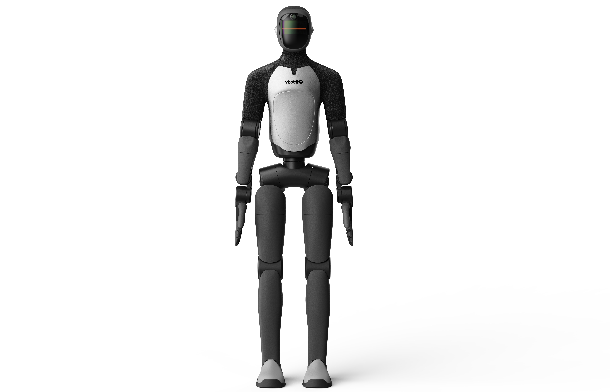
*图 4-25：维他动力 ATOM 人形机器人（多体协作的同族形态）*

---

## 🚨 CASE-06 小安 (Life Rescue)：360° 智能搜救机器狗

* **使用产品**：Vbot + Insta360 X4 + RDK + 多模态 AI｜**赛道**：应急救援
* **指挥界面 Demo**：[rescue-command-center](https://1ivy403.github.io/rescue-xiaoan/demo/rescue-command-center/)
* **现场一句话**：*“指挥界面亮出救援优先级的那一刻，评委席安静了。”*

### 🎬 作品演示视频

<video src="../assets/videos/xiaoan-rescue-demo.mp4" controls width="640"></video>

👉 [点击观看：小安搜救演示（mp4，约 7.6MB）](../assets/videos/xiaoan-rescue-demo.mp4)

### 三类现场难题 → 四件设备拼成系统

| 难题 | 解法 |
| :-- | :-- |
| 救援人员无法安全快速进入高风险区域 | **Vbot 机器狗**进入难以抵达的废墟 |
| 普通摄像头有盲区，受困者易被遮挡 | **Insta360 X4** 采集回传 360° 画面 |
| 视频零散，难判断“谁最危险、先救谁、如何救” | **多模态 AI** 持续理解现场 + **救援指挥界面**输出优先级 |
| 音视频处理与设备控制 | **RDK** 算力板 |

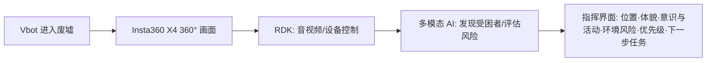

- **输出内容**：受困者位置与明显外貌特征；意识回应、活动能力、受压情况；松动构件、道路遮挡、积水等环境风险；救援优先级；救援组与机器狗下一步任务；对意识清醒者的应急补给建议；
- **边界克制**：**只分析视频与音频中可观察到的生命迹象，不替代专业医疗检测**；
- **硬件对照**：外挂相机与 RDK 属 [4.2 外接算力板](4.2-hardware-modifications.md) 方案，务必遵守 5 kg 额定载荷与 CPU 预留 2 核的约束。

---

## 🛠️ 现场技术幕后：6 个项目共同踩过的坑

| 事件 | 经过 | 给你的启示 |
| :-- | :-- | :-- |
| **深夜 4GB OTA** | 赛前夜 3 台 EDU 逐台升级，凌晨 0:23 完成；困扰链路的 **8787 端口（Agent HTTP API `192.168.127.10:8787`）问题**随新固件解决 | 比赛/工作坊前**务必统一固件版本** |
| **绑定风暴** | Day 1 大量机器开机无法站立、无二维码、无法连 App，后台改绑 SN 码逐台解决 | 开箱后先自检再分发 |
| **社区教程力量** | 一份“网线转 Type-C + 固定 IP `192.168.126.100/24` + `ssh vbot@192.168.126.2` + Python 示例”的教程在选手间传开：“根据教程，我们 1、2 成功了” | 对应 [1.1](../01-getting-started/1.1-unboxing-and-network.md) |
| **API 接力** | 官方在群里提供通过 HTTP API 控制移动的 Python 示例，被多支队伍复用 | 先复用，再创新 |
| **闪送补给线** | 狗绳、背板、狗框多轮闪送 | 配件备足冗余，预留后勤预算 |
| **技术趋同** | **5 支队伍不约而同选择“语音大模型 + 双目视觉”** | 大模型做理解决策、视觉做感知、机器狗做执行——具身开发范式在收敛 |

### 📅 96 小时时间线

| 时间 | 事件 |
| :-- | :-- |
| Day 0 · 08-26 | 硬件运抵场馆 |
| Day 1 · 08-27 | 8 台开箱点检（SSH + `/vel_cmd`）、开幕式、赛前 15 分钟开发培训、通宵开发启动 |
| Day 2 · 08-28 | 绑定/连接问题集中爆发，社区互助，配件闪送 |
| Day 3 · 08-29 | 联调期，深夜 4GB OTA，创造奖评选口径同步 |
| Day 4 · 08-30 | 路演评审，创造奖揭晓，逐台回收 |

---

## 🔬 六案例技术能力对照矩阵

| 能力 | 聆灵 | 伽伽狗 | 牛来芭比 | PoopSense | 她的视界 | 小安 |
| :-- | :-: | :-: | :-: | :-: | :-: | :-: |
| 语音交互 / 大模型 | ✅ | ✅ | ✅ | ✅(Agent) | — | ✅(多模态) |
| 视觉感知 | ✅ 端侧 | ✅ YOLO-Pose | — | — | ✅ 双目+全局 | ✅ 360° |
| 导航 / 避障 | ✅ | ✅ 近人避让 | — | ✅ | ✅ | ✅ |
| 硬件改装 | 药篮+AED+摄像头支架 | 耳朵尾巴 | 3D 外壳+服装 | 感知模块 | 多机体协作 | 全景相机+RDK |
| 自定义唤醒/人设 | — | ✅ “伽伽” | ✅ 牛来人设 | — | — | — |
| 本章最值得抄的配方 | 防跟丢状态机 | 姿态角度判定 | 微动作垫场 | 感知→Agent→执行分层 | 多体分工 | 指挥界面优先级输出 |

---

## 💡 黑客松快速夺奖的极客经验

1. **先拿真机，再做设计**：聆灵第一分钟就去申请 EDU 真机；
2. **先做闭环，再做复杂**：先跑通“语音识别 → 走两步 → 屏幕表情”最小闭环，再叠加大模型；
3. **从真实痛点出发**：宁可推翻伪需求，也不为用技术而造场景；
4. **用工程约束做设计**：伽伽狗的视觉盲区变成“低头看你”，牛来的网络延迟变成“蠢萌反射弧”；
5. **功能冲突要提前排优先级**：安全停机 > 用户打断 > 动作响应 > 闲时游荡；
6. **善用官方资源**：动作库、NPU 内置感知模型、官方 Python 示例，切忌重头造轮子；
7. **安全急停随身带**：上台路演务必指派一名组员手持急停待命，确保评委与观众绝对安全。

> 🎙️ **【直播收尾】** *“六个项目，六种温度：陪诊、陪练、陪笑、陪伴、陪行、陪救。技术路线惊人一致——大模型理解、视觉感知、机器狗执行。下一个故事，等你来写！”*

遇到设备突发状况时，请翻阅 [05 故障诊断与安全指南](../05-diagnostics-faq/5.1-four-layer-diagnostics.md)。
