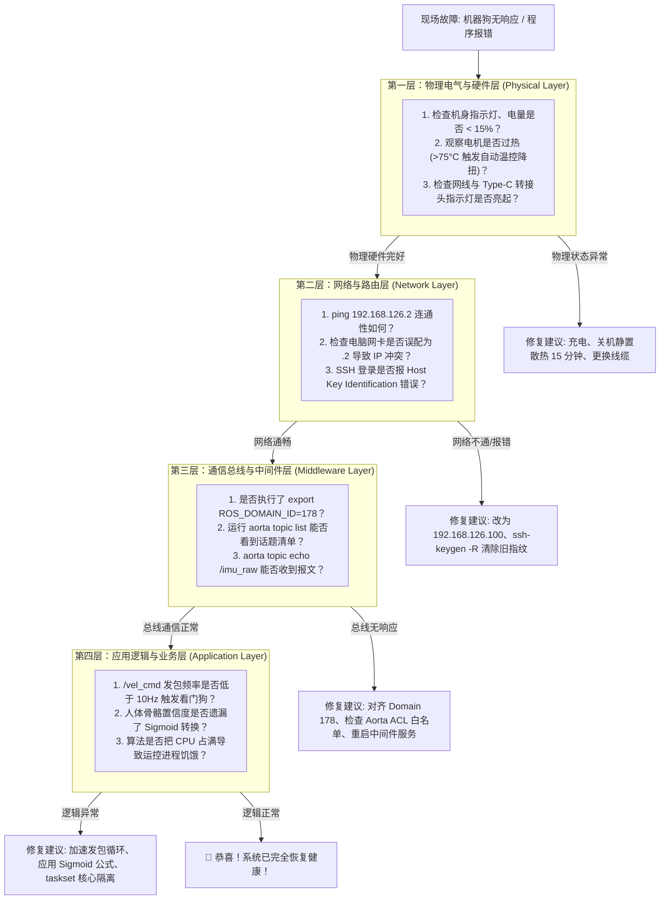

# 5.1 物理-网络-中间件-应用 四层隔离排障法

> 🎙️ **【直播口播导语】**  
> *“在复杂的机器人系统中，当‘机器狗不动’或‘程序收不到数据’时，盲目重启或在代码里乱加 print 只会浪费宝贵的时间！  
> 老练的现场支持工程师手中都有一张‘故障定位地图’——**从物理层、网络层、中间件层到应用层的四层分层隔离诊断法**！  
> 哪怕遇到再离奇的灵异现象，跟着这张图走，3 分钟之内必定锁定根因！”*

---

## 🪜 一、四层排障总览图



---

## 🔍 二、分层逐项诊断指南

### 1. 物理层 (Physical Layer)
* **网口灯检查**：插上有线网卡后，观察转接头指示灯。绿灯常亮、黄灯闪烁代表物理电气链路正常；若灯不亮，换插 Type-C 接口或检查转接头芯片。
* **关节温度与电量**：
  * 电量低于 10% 时，系统会限制大电流输出；
  * 若长时间高负荷测试导致任一关节电机温度超过 **75°C**，系统会触发自动降扭温控保护，表现为步态无力、容易跪倒。此时应静置关机散热 15 分钟。

### 2. 网络层 (Network Layer)
* **IP 冲突诊断**：
  * 执行 `ping 192.168.126.2`。如果 ping 不通，首先检查电脑是否手抖将本机网卡配成了 `192.168.126.2`（自身与自身冲突）；正确配置应为 `192.168.126.100`。
* **SSH 密钥冲突报错**：
  * 若提示 `WARNING: REMOTE HOST IDENTIFICATION HAS CHANGED!`，通常是由于借测了另一台机器狗，指纹不一致。在本地电脑执行一键清理：
    ```bash
    ssh-keygen -R 192.168.126.2
    ```

### 3. 中间件层 (Middleware Layer)
* **Domain 178 对齐**：
  * 确保所有终端与脚本均已执行 `export ROS_DOMAIN_ID=178`。
* **Aorta 命令行万能探针**：
  直接在主板终端使用 Aorta CLI 工具验证总线健康状态：
  ```bash
  # 1. 列出当前总线上所有活跃话题
  aorta topic list

  # 2. 采样 1 条 IMU 原始报文验证数据流
  aorta topic echo /imu_raw --count 1

  # 3. 列出所有可用服务
  aorta service list
  ```
* **ACL 拒绝静默丢弃**：若向自定义话题发布数据但下游收不到，检查是否存在未授权的私有路由，EDU 默认仅允许 Schema 白名单内的话题。

### 4. 应用层 (Application Layer)
* **发包频率抖动导致看门狗抽搐**：
  * 检查发送循环是否加入了耗时的大型同步阻塞操作（如网络爬虫或高耗时图形绘制）。若发包间隔超过 **0.5s**，底层看门狗会自动刹车。必须将网络通信与运控拆解在独立线程中执行。

---

## 📋 三、高频故障极速排查大字典 (FAQ)

| 序号 | 故障报错现象 | 根本诱因剖析 | 10秒极速解决方案 |
| :---: | :--- | :--- | :--- |
| **01** | `ssh vbot` 提示 `Connection refused` 或超时 | 有线网卡松动、连错 Wi-Fi、或电脑网卡未配静态 IP | 检查物理接线，确认电脑 IP 为 `192.168.126.100` |
| **02** | `WARNING: REMOTE HOST IDENTIFICATION HAS CHANGED` | 借用了另一台同 IP 的机器狗，SSH 公钥指纹变动 | 本地电脑执行 `ssh-keygen -R 192.168.126.2` |
| **03** | 执行 `ros2 topic list` 终端空空如也，看不到任何话题 | 终端环境变量未注入，或者默认 Domain ID 不匹配 | 执行 `export ROS_DOMAIN_ID=178` |
| **04** | 向 `/vel_cmd` 发布速度指令，机器狗四肢抽搐一下就不动了 | 只发了单包，底层看门狗在 0.5s 无新指令后安全停机 | 必须编写循环，以 **10Hz ~ 20Hz** 的频率持续发包 |
| **05** | 向 `/vbot/sportmode_cmd` 发送指令没有任何反应 | **该接口在 1.6 版本已彻底废弃**，系统无任何节点监听 | 全面迁移至官方唯一标准速度接口 `/vel_cmd` |
| **06** | 机器狗走着走着突然四脚朝天瘫倒在地 | 视觉/音频大模型占满 8 个 CPU，底层运控心跳超时摔机 | 使用 `taskset -c 2-7` 将 AI 脚本绑定至后置核心 |
| **07** | 人体姿态识别 `/perception/poses` 所有关键点置信度全被过滤 | 误把未激活的 Logit 实数当成了 0~1 的置信度概率 | 对 confidence 应用公式 `prob = 1 / (1 + exp(-logit))` |
| **08** | 执行音频相关脚本报错提示权限被拒绝 (Permission Denied) | 官方合规要求：麦克风监听必须经由用户显式授权 | 在命令行参数中追加 `--consent` 授权标志 |
| **09** | 机器狗行走时四肢疲软无力，甚至无法正常站立 | 关节高负荷运转导致电机温度超过 **75°C**，触发降扭 | 关机静置 15 分钟，待机身降温后重新开机 |
| **10** | 电池指示灯红光快速闪烁，拒绝起立 | 动力电池电量低于 **10%**，系统进入低压自保模式 | 插上官方动力充电器，充至 30% 以上再测试 |
| **11** | 在主板执行 `pip install` 提示网络连接失败 | 计算主板默认未配置外网网关，无法直接联网 | 使用本文档推荐的离线 Wheelhouse 或容器化编译 |
| **12** | 订阅双目相机画面时，程序延迟高达数秒 | 接收队列无界导致历史帧积压在内存中 | 将接收队列深度严格限定为 `max_depth=16` 并丢弃旧帧 |
| **13** | 机器狗开机后卡死在开机自启动脚本中，无法登录 | 在自启动脚本中写了前台死循环，阻塞了系统登录终端 | 将自启动脚本改用 `nohup ... &` 并放入后台运行 |
| **14** | RCP 任务下发后返回被拒绝 (Rejected) | 资源冲突（例如身体动作正在执行，又重复请求了 LEGS） | 检查当前是否有未退出的 Daemon 动作占用资源 |
| **15** | 激光雷达点云坐标系漂移严重 | 在大理石反光地面导致点云产生镜面噪点 | 调高轮式里程计融合权重，增加原地微小旋转重定位 |

在最后一章 [5.2 开发者安全守法规约与自启动防死锁](5.2-safety-and-guardrails.md) 中，我们将为整套开发之旅筑起最关键的一道安全长城！
