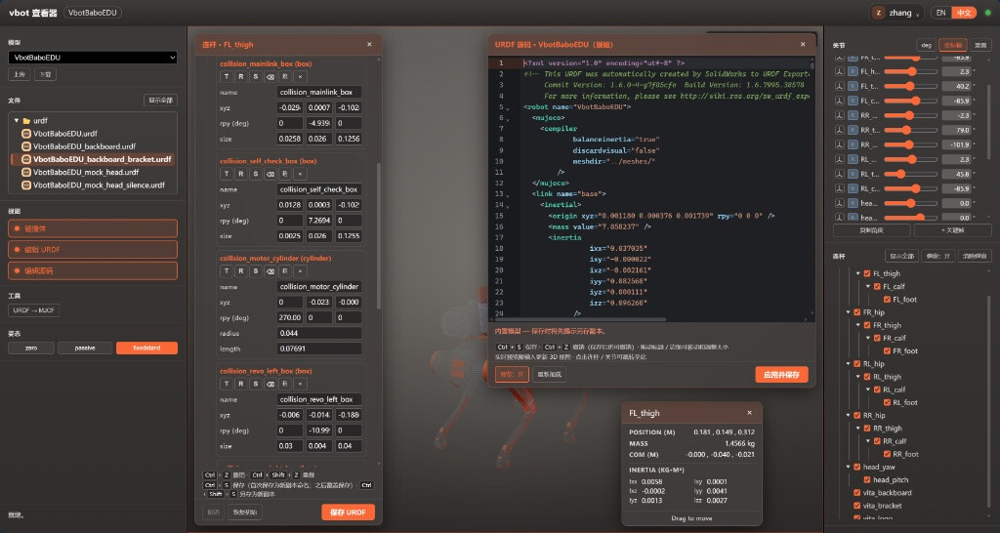

# VBOT EDU：掌握 Agent-Native 机器人开发 —— 开发者文档库总纲与直播讲义

> **定位**：面向具身智能极客、机器人创客、高校科研团队，以及 **AI Coding Agent** (Cursor / Claude Code) 的全景入门与实战指南。  
> **教学范式**：*“案例先导 ➔ 双脑地基 ➔ Agent-Native 编排 ➔ 硬件改装 ➔ 分层排障”* —— 兼具人类极客直播讲授与大模型机器自动路由的双驱动架构。  
> **基准版本**：机器人应用固件 **V1.6.0** (foot_quadruped) ｜ 通信核心：**Aorta (Zenoh)** 原生总线 (46 核心话题) + ROS 2 Humble 桥接子集。
>
> **🌐 网页版教程（GitHub Pages）**：仓库根目录 [`index.html`](index.html) 即课程首页（含大头 EDU 官方展示视频），发布地址为 [https://00make.github.io/vbot-docs/](https://00make.github.io/vbot-docs/)。5 个模块目录下既有 Markdown 源文档，也有对应的 `index.html` 与 `lesson_XX.html` 网页课页。

---

## 🗺️ 文档库 5 大核心功能模块架构

```
vbot-docs/
├── README.md                          # 📖 文档库全局总览、直播讲义路线图与学习总纲
├── AGENTS.md                          # 🤖 Coding Agent 任务路由表与安全约束规约
├── CLAUDE.md                          # ⚡ Claude Code 规则配置与执行指令入口
├── catalog/
│   └── capabilities.json              # 📋 14 项全机物理能力与接口结构化索引
├── assets/                            # 🖼️ 自包含媒体资产（图片 + 演示视频，独立分支零外部依赖）
│
├── 01-getting-started/                # 🚀【模块一】快速开始与第一公里（开箱、网络、Hello World）
│   ├── 1.0-vbot-edu-overview.md       # 走进 VBOT 大头 EDU（产品全景、S100P 规格、消费版vsEDU对比与发布视频拆解）
│   ├── 1.1-unboxing-and-network.md    # 极速开箱与网络接入（有线 eth2 静态规划与 1.6 板载 WiFi 直连）
│   └── 1.2-hello-world-motion.md      # 15 分钟跑通 Hello World：/vel_cmd 20Hz 运控与安全停车
│
├── 02-architecture-comm/              # 🔌【模块二】架构拓扑与通信机制（双脑、Zenoh/ROS2、环境）
│   ├── 2.1-dual-brain-architecture.md # 双大脑硬件分工（大脑皮层 vs 神经系统）与无 wlan0 边界解析
│   ├── 2.2-zenoh-and-ros2-bridge.md   # Aorta (Zenoh 46话题) 原生总线与 ROS 2 本地兼容子集破壁
│   └── 2.3-dev-environment-setup.md  # DevContainer、五步部署法、Bazel 编译与生产级 Python 骨架
│
├── 03-embodied-agent/                 # 🧠【模块三】运控、感知与多模态 Agent（/vel_cmd、传感器、大模型）
│   ├── 3.1-motion-control-and-rcp.md  # 运动控制进阶与 RCP DAG 任务图（告别离散速度，声光动作流）
│   ├── 3.2-perception-data-streams.md # 激光点云切片、双目 H.265 硬件解码与 17 点骨骼 Logit 转换
│   └── 3.3-ai-native-multimodal.md    # 语音唤醒词替换、VLM 视觉决策与设备端 18080 MCP 工具服务
│
├── 04-hardware-recipes/               # 🛠️【模块四】硬件改装与标杆案例库（CAN总线、6大黑客松案例）
│   ├── 4.1-specs-and-constraints.md   # 物理尺寸、算力隔离（预留 2 核）与 5kg 额定/12kg 极限负重
│   ├── 4.2-hardware-modifications.md  # 3D 打印外壳、CAN 总线集成 PiPER 六轴机械臂与外接算力板
│   └── 4.3-hackathon-blueprints.md    # 6 大黑客松标杆案例深度复盘（聆灵、伽伽狗、牛来芭比、PoopSense、她的视界、小安）含视频与实拍
│
└── 05-diagnostics-faq/                # 🩺【模块五】故障诊断与安全指南（4层诊断法、看门狗、自启动）
    ├── 5.1-four-layer-diagnostics.md  # 自底向上“物理-网络-中间件-应用”四层隔离排障法与 15+ 极速 FAQ
    └── 5.2-safety-and-guardrails.md   # 软硬件急停绝对防线、三大交通规则与 flock 开机自启动守护
```

---

## 🎯 5 大核心功能模块深度导读

| 模块 | 核心内容 | 人类开发者目标 (直播教学要点) | AI Agent 协作与规约要点 |
| :--- | :--- | :--- | :--- |
| **[01 快速开始](01-getting-started/1.0-vbot-edu-overview.md)** | 大头 EDU 产品全景、地瓜 S100P 128TOPS 算力、消费版 vs EDU 对比、官方发布视频拆解、开箱接线、静态 IP (`192.168.126.100`)、1.6 板载 WiFi、SSH 免密、`/vel_cmd` 20Hz 运控 | **15 分钟内消解软硬件畏难情绪，建立具身认知，让机器狗安全迈出物理第一步**；演示废弃接口 `/vbot/sportmode_cmd` 的静默丢弃陷阱 | 掌握 EDU 规格边界，校验本地网段，生成带 `--confirm-motion` 与看门狗安全停车的生产级循环脚本 |
| **[02 架构拓扑](02-architecture-comm/2.1-dual-brain-architecture.md)** | 双脑硬件分工（计算板 `192.168.126.2` vs 网关板 `192.168.127.10`）、Aorta (Zenoh) 主干、五步端到端部署工作流 | 彻底搞清为什么 Linux 里找不到 `wlan0`；破除 PC 端 FastRTPS 与板载 Zenoh 的“协议巴别塔” | 遵守 Aorta 56 行 EDU Schema 白名单与 Domain 178 约束；严格采用共享内存低延迟模式 |
| **[03 具身智能](03-embodied-agent/3.1-motion-control-and-rcp.md)** | RCP 动作流平滑插值、双控制路径严苛互斥、双目 H.265 解码、17 点骨骼 Logit 转换、18080 HTTP MCP 工具服务 | 掌握声光屏表情多模态并发编排；学习将大模型提示词编译为结构化具身动作；接入视觉 VLM | 严格遵守 RCP 资源锁契约；对人体关键点置信度强制实施 Sigmoid 数学映射；通过 MCP 规范对外暴露工具 |
| **[04 硬件改装](04-hardware-recipes/4.1-specs-and-constraints.md)** | 5kg 额定/12kg 极限负重、PiPER 六轴机械臂 CAN 接入、算力隔离预留 2 核、6 大黑客松真实获奖案例复盘 | 学习 3D 打印轻量化改装经验；掌握机械臂供电与总线接线；深度拆解聆灵陪诊、伽伽狗等得奖项目 | 生成高负载视觉/音频代码时，强制使用 `taskset -c 2-7` 为底盘运控保留 CPU 0/1 核心 |
| **[05 诊断与安全](05-diagnostics-faq/5.1-four-layer-diagnostics.md)** | 物理-网络-中间件-应用四层排障法、15+ 典型 FAQ、硬件急停 vs 软件取消、flock 防死锁开机自启动守护 | 建立自底向上的分层定位直觉，3 分钟排查所有疑难杂症；编写可落地的商业化开机自启动守护 | 贯彻“读先于写、强制有界、零越级旁路”三大交通规则；绝不开机无条件触发运动 |

---

## 🎙️ 直播讲义与极客教学心法

针对开发者直播授课或线下工作坊，本套文档深度融合了 **“案例先导”** 的叙事架构：
1. **先看神仙打架与产品全景 (从 [4.3 黑客松标杆案例](04-hardware-recipes/4.3-hackathon-blueprints.md) 或 [1.0 大头 EDU 全景与视频拆解](01-getting-started/1.0-vbot-edu-overview.md) 切入)**：播放 37 秒官方发布视频，展示戴护士帽的 LinBot 医院陪诊导医、做下犬式的 YogaGo 瑜伽搭子、灵动眨眼的交互“大头”，迅速激发多巴胺；
2. **直击底层根基 (进入 [01 快速开始](01-getting-started/1.1-unboxing-and-network.md) 与 [02 架构拓扑](02-architecture-comm/2.1-dual-brain-architecture.md))**：用生物学的大脑皮层与神经系统比喻双脑硬件，揭秘 Aorta 46 核心话题；
3. **迈向具身跃迁 (进入 [03 具身智能](03-embodied-agent/3.1-motion-control-and-rcp.md))**：告别离散速度折磨舵机，用 RCP DAG 和 MCP 工具服务赋予机器狗听觉、视觉与大模型灵魂；
4. **守牢工程底线 (进入 [04.1 硬件约束](04-hardware-recipes/4.1-specs-and-constraints.md) 与 [05 诊断安全](05-diagnostics-faq/5.1-four-layer-diagnostics.md))**：为运控死死锁定 2 个 CPU 核心，牢记三大安全交通规则与排障字典。

---

## 📸 嵌入的高清图片资产索引

- **外观与仿真**：
  - 
  - 
  - 
- **LinBot 聆灵陪诊**：
  - 
  - 
  - 
- **YogaGo 伽伽狗**：
  - 
  - 
  - 
- **牛来芭比潮玩机甲**：
  - 
  - 
  - 
  - 
- **开发与协作**：
  - 
  - 
  - 

---

## 🤖 AI Agent (Cursor / Claude Code) 使用规约

AI 编程助手在协助开发者编写代码时，请严格遵守 [AGENTS.md](AGENTS.md) 与 [catalog/capabilities.json](catalog/capabilities.json)：
1. **事实第一**：接口名称与字段必须依据 Schema 与 Catalog，严禁凭空臆造 Topic 名称；
2. **离线安全优先**：默认生成的 CLI 程序应当具备离线预览保护，仅在显式传递 `--execute` 与 `--confirm-motion` 时下发物理运动指令；
3. **算力隔离**：生成高负载推理代码时，必须主动添加 CPU 亲和性隔离逻辑（`taskset -c 2-7`）。


